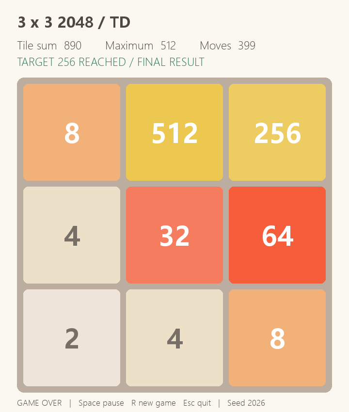

# 3×3 2048 自主游戏：MC、TD 与完整规划

在原项目环境上探索并保留三个自主游戏版本，目标是在3×3棋盘上尽量增加终局数字总和，同时尽可能达到256。默认版本为256概率优先的完整规划。

## 1. 游戏规则与评价指标

- 棋盘3×3，初始两个数字块；空格均匀选择，生成2的概率为90%、4为10%。
- 动作是左、右、上、下；只选择合法动作，每次有效动作后生成一个新块。
- 达到256后继续，直到无合法动作。失败局也计入统计。
- 主统计是终局九个数字的总和，另报 `P(max_tile ≥ 256)`、`P(max_tile ≥ 512)`；合并得分不是数字总和。

随机生成数字意味着达标率并非逐局保证。推荐方法属于已知环境模型的规划，不属于强化学习。

## 2. 当前三个版本及结果

三项使用同一批500个新测试种子 **5000000–5000499**；评测不重新训练或调参。

| 版本 | 方法 | 平均终局总和 | 总和95%区间 | ≥256 | ≥512 |
|---|---|---:|---|---:|---:|
| `mc` | MCTS，128次模拟、深度12 | 280.164 | [272.53, 287.64] | 34.4% | 0.0% |
| `td` | 乐观初始化、对称5-tuple TD，30万局 | 639.408 | [619.56, 658.11] | 92.6% | 54.6% |
| `best`（默认） | 256概率优先＋完整总和规划 | 803.580 | [785.43, 822.05] | 99.8% | 72.8% |

[逐局原始数据](docs/experiments/selected/raw/) · [配置与权重校验值](game2048/selection.json) · [逐局一致性验证](docs/experiments/publish-verification/summary.json)

推荐版本在另一批独立10000局（2000000–2009999）中，平均总和为 **812.9164**，≥256为 **99.59%**，≥512为 **74.02%**。这批结果与上表500局分开报告。[独立验证数据与区间](docs/experiments/history/round3/final/holdout_summary.json)



## 3. 快速运行

推荐使用 Python 3.12。Windows PowerShell：

```powershell
python -m venv .venv
.\.venv\Scripts\python.exe -m pip install -e ".[test]"
.\.venv\Scripts\python.exe -m game2048.autoplay --agent best
```

双击 `play.bat` 可选择三个版本，直接回车运行推荐版本；`play_mc.bat`、`play_td.bat`、`play_best.bat` 分别直接启动。窗口内空格暂停，R开始新局，Esc退出。

```powershell
.\.venv\Scripts\python.exe -m game2048.autoplay --agent mc
.\.venv\Scripts\python.exe -m game2048.autoplay --agent td
.\.venv\Scripts\python.exe -m game2048.autoplay --agent best --headless --games 100 --seed 6000000
```

安装后的 `game2048-play`、`game2048-auto` 均进入这三个版本。Linux/macOS 使用对应虚拟环境中的 `python` 即可。首次启动需要加载权重及Numba编译；正常游戏无需重新训练或求解。

## 4. 三个方法的思路

### MC：蒙特卡洛树搜索

每次决策进行128次树搜索模拟，最长模拟12步；结合树选择、随机后续落块及局面评价选择动作。保留原仓库MCTS参数和随机序列，用Numba移植加速，无训练权重。[实现](game2048/wrappers/MCTS/fast.py)

### TD：对称5-tuple后继状态价值学习

三个基础5格模式在棋盘8种旋转／镜像下共享查表权重，将各模式估值相加得到移动后、随机落块前的价值 `V(afterstate)`。训练用TD(0)更新：

```text
δ = 新生成数字的值 + V(下一后继状态) − V(当前后继状态)
```

折扣为1，终局后续价值为0，不额外奖励256。由此累计奖励对应新增数字总和。共享特征重复出现时按特征平方范数归一化更新。初始总估值约300，鼓励探索；动作探索率和学习率随训练阶段降低。推理只比较四个合法移动的后继状态价值，不叠加多层搜索。[策略](game2048/wrappers/TD/optimistic.py) · [训练内核](game2048/wrappers/TD/optimistic_training.py)

### 推荐：完整期望规划

枚举每个合法动作、全部空格以及新块2/4的概率。每个有效回合落块后总和严格增加，因此可按递归动态规划计算完整后续期望并缓存状态。

达到256前优先最大化最终达标概率，在概率差不超过数值容差时以期望总和打破平局；达到256后只最大化期望终局总和。离线计算后将棋盘对称归一化，仅保存动作表，运行时直接查询。[动作表查询](game2048/wrappers/Expectimax/tablebase.py) · [完整求解器](game2048/wrappers/Expectimax/solve_full.py)

使用float64，概率容差1e-12、总和容差1e-10，无学习边界估值；这是数值完整规划结果，没有附形式化最优性证明。求解记录包含约3.889亿总和状态和4868万达标前状态。[计算记录](docs/experiments/selected/solve.json)

## 5. 训练与计算资源

| 方法 | 离线训练／计算 | 在线决策 |
|---|---|---|
| MC | 无训练 | 每步128次模拟，深度12 |
| TD | CPU、30万完整游戏、训练种子42 | 一步后继状态查表 |
| 推荐 | CPU完整动态规划、概率优先策略求解与动作表压缩 | 对称归一化＋动作表查询 |

TD每10000局为一批，批种子为 `42 + 已完成局数`；学习率前70%为0.1、之后0.03，探索率前80%为0.02、之后0.002。原始训练记录约64.3秒，依赖当时硬件和编译缓存，不代表跨机器速度保证。[训练记录](docs/experiments/selected/td-training.json)

规划原始记录中纯总和求解约274.9秒，概率优先部分约57.7秒，压缩另计。运行时解压后动作表数组约224MiB；重新求解需分配约22GB基础数组，宜使用有充足可用内存的机器。发布的 `.npz` 已可直接运行。

**训练资源没有完全控制一致。** 历史比较统一了评测规则、种子和局数，未统一训练局数、交互步数或训练／推理耗时。后来的资源统一补充实验因用户要求已取消，PPO未全部完成，不作为完整新榜单，也未替换当前权重。[状态说明](docs/experiments/cancelled-resource-comparison/CANCELLED.md)

## 6. 复现评测与训练

```powershell
# 三版本新种子评测
.\.venv\Scripts\python.exe -m game2048.evaluate --agent all --games 100 --seed 6000000
# 完整重放500局/版本，逐局核对总和、最大块、步数及合并分
.\.venv\Scripts\python.exe -m game2048.evaluate --verify-retained
# 当前版本测试
.\.venv\Scripts\python.exe -m pytest tests -q
# 可选：从头训练TD，输出到新目录，不覆盖发布权重
.\.venv\Scripts\python.exe -m game2048.wrappers.TD.train_optimistic --episodes 300000 --seed 42
# 可选：重新求解完整规划，需充足内存
.\.venv\Scripts\python.exe -m game2048.wrappers.Expectimax.solve_full
```

评测为每个种子预先生成独立的落块随机数带；策略自己的随机数流与环境分离。相同种子约束相同回合的随机输入，但不同动作会改变空格布局，实际落块位置随棋盘变化。评测输出默认为 `docs/experiments/evaluation/`。

TD训练入口使用原始训练内核与批次安排。跨NumPy/Numba版本的浮点和随机实现可能影响重训轨迹；复现发布结果应使用本仓库权重及SHA256校验。

## 7. 完整探索榜单

完成了多轮探索与58项固定策略／训练对照的共同500局评测，共29000局。[完整58项榜单](docs/experiments/history/leaderboard/LEADERBOARD.md) · [CSV](docs/experiments/history/leaderboard/leaderboard.csv) · [完整实验材料](docs/experiments/README.md)

58项包括45个去重配置、5个加长训练对照、2个训练种子对照和6个仓库基线条目。按平均总和，45号为816.22、当前默认46号为803.58；配对差95%区间为[-3.42,29.22]，不足以据这500局切换已冻结并完成万局验证的默认策略。


## 8. 目录与模型

沿用原仓库 `game2048/wrappers/<方法>/models` 和 `docs` 结构：

```text
game2048/
  agents.py, autoplay.py, evaluate.py   # 三版本选择、界面和评测
  engine.py, selected_env.py           # 保留策略的快速规则与Gym环境
  selection.json                      # 配置、来源与模型SHA256
  wrappers/
    MCTS/fast.py                      # MC，无权重
    TD/optimistic*.py, train_optimistic.py
    TD/models/optimistic-5tuple-300k.npz
    Expectimax/tablebase.py, solve_full.py
    Expectimax/models/lex.npz, mass.npz
docs/
  experiments/                        # 当前结果、历史完整榜单及原始数据
  history/README-upstream-fc62be0.md    # 本次修改前的原仓库报告
tests/test_three_versions.py
play*.bat
```

TD权重约0.85MiB，两个规划动作表压缩后约8.40MiB及60.86MiB。三个文件的SHA256见选择记录。没有上传虚拟环境、编译缓存、临时GPU运行库及取消实验的未完成模型。

## 9. 原仓库兼容与历史记录

原仓库CNN TD、PPO与旧Expectimax实现、权重及已有 `docs` 报告保留，方便复核旧实验；不属于当前默认三版本菜单。旧命令可通过 `game2048-legacy` 或 `python -m game2048.play` 使用，仍按原要求安装 `.[td]` 或 `.[ppo]`，旧原生Expectimax依赖POSIX环境。

原始Gym注册 `Game2048-v0` 保持原仓库接口。当前三版本界面使用恢复版本的 `selected_env.Game2048Env`；共同榜单使用固定随机数带的快速评测器。两者动作和合并规则一致，随机数生成接口不同，不应把同一个种子的界面演示当作榜单逐局重放。

本次修改基于 [fc62be0aeb8a](https://github.com/riyuexingchennnn/game2048/commit/fc62be0aeb8a660a996cca54f517d119d817fbe7)。[原README与原100局报告](docs/history/README-upstream-fc62be0.md)按历史材料保留，不能与当前500局榜单混用。

## 10. 验证与局限

检查覆盖模型哈希、三个版本整局运行与可重复性、Gym接口、达到256继续游戏、合法动作、棋盘移动规则及共同500局逐行一致性。[本次发布检查结果](docs/experiments/validation.json)

历史58项采用各自既定训练预算，是固定策略的效果对照；多轮探索和选择也带来选择偏差。独立万局验证只比较当时冻结的默认规划与旧冠军，没有对全部58项做同规模独立检验。计时受硬件、JIT编译、缓存及运行负载影响。

## 11. 许可

沿用 [MIT License](LICENSE)。MCTS的移植来源及许可另见 [THIRD_PARTY_LICENSES.md](THIRD_PARTY_LICENSES.md)。
