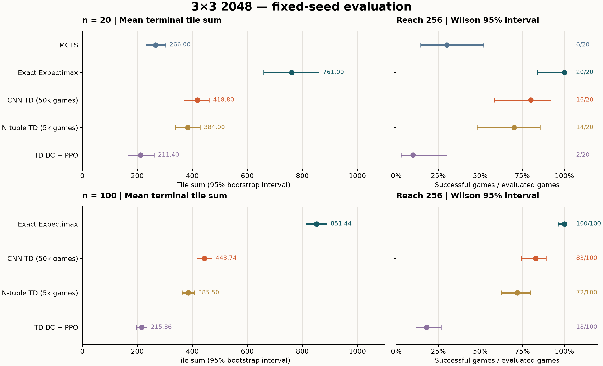
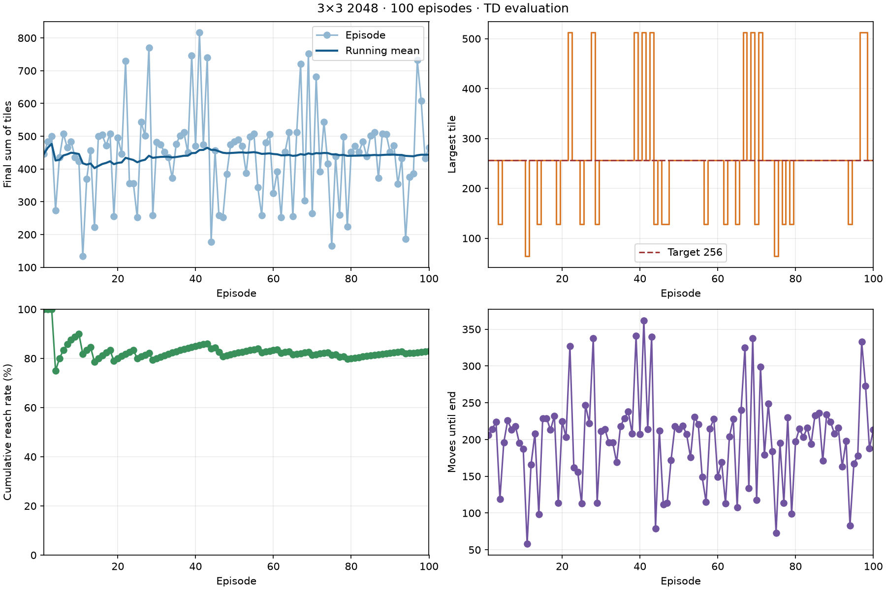

# 3×3 2048 策略实验报告

本项目比较 MCTS、完整终局 Expectimax、CNN TD-afterstate、旧 n-tuple TD，以及使用 TD 教师预训练的 PPO。研究目标是：**提高自然终局的棋盘数字总和，同时提高达到 256 的概率**。达到 256 后继续游戏。

截至 **2026-11-04**，在环境种子 10000–10099 的 100 局评测中，完整 Expectimax 平均终局总和为 **851.44**、256 达标 **100/100**；默认 CNN TD 为 **443.74**、**83/100**；旧 n-tuple TD 为 **385.50**、**72/100**；TD 行为克隆后继续训练的 PPO 为 **215.36**、**18/100**。MCTS 目前只有同组前 20 局的记录，平均总和 **266.00**、**6/20** 达标。各方法训练量与在线计算量不同，下面分别报告。



图中 20 局与 100 局使用相同的起始种子；20 局是 100 局的子集。误差线衡量固定模型在这些棋局上的采样波动，不能代表多次独立训练的稳定性。

## 目录

- [1. 游戏规则与研究目标](#1-游戏规则与研究目标)
- [2. 指标定义与统计方法](#2-指标定义与统计方法)
- [3. 实验协议与数据来源](#3-实验协议与数据来源)
- [4. 方法与实际配置](#4-方法与实际配置)
- [5. 统一评测结果](#5-统一评测结果)
- [6. 训练过程与学习诊断](#6-训练过程与学习诊断)
- [7. 文献成绩的对照口径](#7-文献成绩的对照口径)
- [8. 运行资源与工程实现](#8-运行资源与工程实现)
- [9. 安装与复现](#9-安装与复现)
- [10. 历史探索实验](#10-历史探索实验)
- [11. 验证范围与结论边界](#11-验证范围与结论边界)

## 1. 游戏规则与研究目标

默认环境为 `Game2048-v0`，棋盘大小为 **3×3**。初始在两个不同空格各生成一个方块；每次生成 2 的概率为 0.9，生成 4 的概率为 0.1，空格位置等概率选择。合法移动先完成滑动和合并，再生成一个随机方块；同一方块在一次移动中最多参与一次合并。

动作编码为 `0=左、1=右、2=上、3=下`。所有参与评测的策略都只选择合法动作。**只有不存在合法动作才自然终局**；达到 256、512 都不会提前停止。本报告的正式评测不设置步数上限。

主指标是终局数字总和 `S`。学习和搜索采用的默认终局效用为：

```text
S = 终局棋盘九个格子的数值之和
I256 = 1（曾达到至少 256），否则为 0
U = S + 256 × I256
```

这是对总和与达标率的加权偏好；奖励权重为 256，不能解释为“必须达标”的硬约束。主表仍分开报告 `S` 与达标率，避免综合效用掩盖两者的差异。

规则实现见 [core.py](game2048/core.py)，随机环境及渲染见 [game2048.py](game2048/envs/game2048.py)。

## 2. 指标定义与统计方法

### 2.1 游戏成绩、达标与生存指标

| 指标 / 数据字段 | 定义与解读 |
| --- | --- |
| 终局总和 `sum` | 本项目主指标 `S`，合并本身不改变它；有效移动生成的新块使其增加 2 或 4 |
| 传统合并分 `merge_score` | 每次合并所得新方块的数值累加，例如 `2+2→4` 加 4 分，`4+4→8` 加 8 分；对应通常 2048 界面的 SCORE |
| 终局效用 `utility` | `U=S+256×I256`，用于核对本项目的默认优化目标；不是界面合并分 |
| 初始总和 `initial_sum` | 初始两个块的总和，可能为 4、6、8 |
| 环境累计奖励 `total_reward` | 每步新生成方块数值累加，精确满足 `initial_sum + total_reward = sum` |
| 总和均值 / 中位数 | 均值衡量平均表现；中位数描述居中棋局，二者都不能代替成功概率 |
| SD / Q25 / Q75 | SD 为样本标准差，分母为 `n−1`；Q25/Q75 为线性插值的 25%/75% 分位数，描述棋局波动 |
| 最低 / 最高 | 本批棋局的极值；最高分是单局结果，不能代替平均成绩 |
| 最大块 `max_tile` | 终局最大方块；它在游戏中不会下降，因此也等于整局达到的最大块 |
| ≥128 / ≥256 / ≥512 / ≥1024 | 达到相应方块的局数除以总局数；各阈值是包含关系，不能相加 |
| 达标率 `reach_rate` | 默认指 ≥256；同时给出成功局数，避免小样本百分比造成误解 |
| 步数 `steps` | 实际执行的合法动作数，不计初始发块 |
| 首次达标步 `target_step` | 第一次达到 ≥256 时已执行的动作数；未达标记为 `null` |
| 达标后步数 `steps_after_target` | 达标棋局的 `steps−target_step`；原始日志中失败局记 0，本报告的条件均值只纳入成功局 |
| 结束原因 `end_reason` | `no_legal_moves` 为自然终局；设定步数上限造成的截断必须单列 |

由于每个合法动作平均增加 2.2 的总和，总和与生存步数通常高度相关；但两者仍分别记录。**总和 443.74、合并分 2652.80、效用 656.22 是三项不同指标**，不能混称为同一个“得分”。

### 2.2 区间与比较

总和及合并分的均值区间使用 **20,000 次棋局重采样的百分位 bootstrap 95% 区间**，随机种子固定为 `20261104`。256 达标率使用 **Wilson 95% 区间**。它们描述固定策略对棋局随机性的估计精度，不包含训练初始化、训练种子或超参数选择造成的变化。

CNN 与旧 TD 的差值先按相同环境种子相减，再对这 100 个差值配对重采样。相同环境种子控制了随机数流；策略不同会产生不同的空格及棋局轨迹，并不意味着两种策略遇到完全相同的棋盘。没有把 20 局与 100 局相加，也没有将其视为两次独立实验。

## 3. 实验协议与数据来源

| 项目 | 本报告约定 |
| --- | --- |
| 公共比较集 | 种子 **10000–10019**，每种方法 20 局，共五种方法 |
| 扩展比较集 | 种子 **10000–10099**，Expectimax、CNN TD、旧 TD、PPO 各 100 局；包含公共比较集 |
| 验证集 | CNN/旧 TD 使用 8000–8099；PPO 历史调参使用其中 8000–8019 |
| 评测策略 | TD 为 `ε=0` 贪心选择，等值时按固定动作 RNG 处理；PPO 为带合法动作屏蔽的确定性预测；MCTS 固定模拟预算 |
| 策略随机种子 | 统一入口逐局使用 `环境种子+100000`，避免与环境 RNG 共用状态 |
| 结束条件 | 无合法动作；正式评测均自然结束，无步数截断 |
| 模型状态 | 使用随仓库保存的固定检查点，评测期间不更新参数 |

旧 n-tuple 训练种子为 2026–7025；PPO 教师数据种子为 7026–7525，PPO 训练入口种子为 2026；CNN 的实际训练阶段种子见第 6 节，均不低于 20000。验证和评测种子未用于这些模型的权重更新。不过，10000–10099 的结果曾在旧 TD 历史探索中查看，因此这里称其为**固定比较集**，不将它包装成从未查看的盲测集。

本轮整理从原始日志重放了 **420 局**：MCTS 20 局，另外四种方法各 100 局。重放逐步核对合法动作、生成奖励、总和、最大块、首次达标步和自然终局；传统合并分另外使用方块势函数 `Σ v·log₂(v)` 的变化扣除发块贡献交叉校验。PPO 的 100 局还逐步验证了当前默认检查点选择的动作与历史日志一致。

| 数据文件 | 内容 |
| --- | --- |
| [统一报告数据](docs/evaluation-report.json) | 五种方法的逐局种子、完整动作串、终局棋盘、合并分、详细统计与区间、源日志哈希、当前模型哈希、PPO 训练诊断 |
| [CNN 训练记录](docs/td-cnn-training.json) | 阶段预算、有效训练时间、配置、计数、每 500 局统计 |
| [CNN 与旧 TD 评测记录](docs/td-cnn-evaluation.json) | 20/100 局评测、100 局验证、模型配置及逐局数据 |
| [Expectimax 评测记录](docs/expectimax-evaluation.json) | 搜索目标、完整状态数及原始 100 局终局记录 |

完整运行日志保存在本地 `log/`，默认不提交；统一报告数据保留了评测动作轨迹，核查成绩不依赖本地日志是否存在。历史探索表中没有保存完整轨迹的结果另行标记，不与本轮重放数据混用。

## 4. 方法与实际配置

### 4.1 方法总览

| 方法 | 决策依据 | 学习预算 / 教师 | 在线工作量 |
| --- | --- | --- | --- |
| MCTS | UCT 树搜索与启发式 rollout | 无训练、无教师 | 每步 128 次模拟，深度 12 |
| 完整 Expectimax | 枚举合法动作和所有随机发块，递推到终局 | 无训练；构建全状态价值缓存 | 首次完整求解，之后查表选动作 |
| CNN TD-afterstate | CNN 预测合法后继状态的终局效用 | 从零自我对弈 50,000 局，无教师、无搜索辅助 | 一批估值当前所有合法后继状态 |
| 旧 n-tuple TD | 启发式先验 + 可学习特征表 | 自我对弈 5000 局，无教师 | 枚举合法后继状态并查特征表 |
| TD 行为克隆 + PPO | 独立策略/价值 CNN，合法动作屏蔽 | 500 局旧 TD 教师数据，12 轮 BC，再训练 50,176 个环境步 | 策略网络推理与动作屏蔽 |

### 4.2 MCTS

每次真实决策重新建树，节点为发块后的棋盘，边为合法动作。选择分数为：

```text
Q(s,a) + 70 × sqrt( ln(N(s)+1) / N(s,a) )
```

未访问动作按启发式优先展开，随后按环境概率采样随机块。树外 rollout 以 0.15 的概率选随机合法动作，其余选择启发式较好的动作。叶节点估值包含总和、空格、八种角落蛇形排列的最大加权和及 ≥256 奖励，无合法动作时扣生存惩罚；回传后选择根节点平均模拟价值最高的动作。

实测配置：`simulations=128`、`depth=12`、`exploration=70`、`rollout_random=0.15`、`empty_weight=18`、`order_weight=1`、`target_bonus=256`。这些是基线参数，没有完整预算扫描或全局寻优。实现见 [MCTS/agent.py](game2048/wrappers/MCTS/agent.py)。

### 4.3 完整终局 Expectimax

玩家节点对合法动作取最大值，随机节点枚举每个空位上的 2/4，权重分别为 `0.9/空位数` 与 `0.1/空位数`。终局价值使用 `U`，不加入空格或蛇形近似。默认深度为 `None`，完整求解到终局；旋转与镜像共八种对称状态共享缓存。

当前内核累计 **48,713,519 个规范化玩家状态、31,431,374 个随机节点**。这是给定规则及终局效用下的完整动态规划参照；它优化的是期望 `U`，不能据此声称单独的期望 `S` 或达标率也分别最优。`--target-bonus 0` 会改成只优化总和，并建立另一份缓存。

接口为 Python，完整状态求解内核目前为 **C++17**，用于行移动查表、棋盘编码和大规模记忆化；C++ 是性能实现选择，算法本身可以用 Python 表达。显式传入 `--depth 3` 则启用原来的**纯 Python 有限深度启发式**版本，它与默认完整求解不是同一项实验。原深度 3 版本的 20 局总和为 325.10、达标 10/20，不能代表当前完整版本。

参考 [Galebach 的 3×3 完整求解文章](https://www.probabilitysports.com/2048.html)；代码和递推说明见 [Expectimax README](game2048/wrappers/Expectimax/README.md)。

### 4.4 CNN TD-afterstate

后继状态 `z` 是滑动合并后、发随机块前的棋盘。采用 [Katsuta（2024）公开摘要](https://www.kochi-tech.ac.jp/library/ron/pdf/2023/03/13/a1240305.pdf)中 Deep 结构的尺寸，以及其引用的 [Matsuzaki（2021）批量 TD-afterstate 方法](https://www.jstage.jst.go.jp/article/ipsjjip/29/0/29_336/_pdf)。

| 层 | 配置 | 输出形状（不含 batch） |
| --- | --- | --- |
| 输入 | 空格、2、4、…、1024，共 11 通道独热编码 | 11×3×3 |
| 公共输入卷积 | 1×1，11→21，ReLU | 21×3×3 |
| 空间卷积 1 | 2×2，21→43，padding=1，ReLU | 43×4×4 |
| 空间卷积 2 | 2×2，43→77，ReLU | 77×3×3 |
| 空间卷积 3 | 2×2，77→85，ReLU | 85×2×2 |
| 空间卷积 4 | 2×2，85→85，ReLU | 85×1×1 |
| 全连接 | 85→85，ReLU | 85 |
| 价值头 | 85→1，线性 | 1 |

参数共 **79,874** 个；四层空间卷积加公共输入卷积，代码中共五个 `Conv2d`。价值头采用线性输出：试训时末层 ReLU 出现恒零并失去梯度，故作此适配。其余初始化、归一化、探索和生成器配置也属于本项目实现范围。

默认网络学习已知棋盘基线之上的剩余效用：

```text
B(z) = sum(z) + 256 × I(max(z) ≥ 256)
V(z) = B(z) + 1024 × CNN(z)

行动选择：       argmax_a V(move(s,a))
相邻后继状态标签：Y_t = stop_gradient(V(z_(t+1)))
自然终局标签：   Y_t = 实际终局总和 + 256 × I256
回归目标：       (Y_t − B(z_t)) / 1024
```

不折扣；新块已经进入后续棋盘总和，不重复累加生成奖励；默认也不加入合并奖励。训练用 ε-greedy 的下一行动生成 TD 标签，评测时 `ε=0`。

| 训练项 | 默认值 / 提供检查点的实际值 |
| --- | --- |
| 优化器 / 损失 | Adam，`eps=1e-7`；停止梯度标签上的 MSE |
| 标签批量 | FIFO 每 1024 条更新一次，末尾不足一批也更新；每条只使用一次 |
| 棋局生成 | 32 个同步棋局批量推理，不代表 32 个进程 |
| 学习率 | 默认 0.001；所提供模型前 10,000 局 0.001，后 40,000 局 0.0003 |
| 探索 | ε 在前 5000 局从 0.10 线性降至 0.01 |
| 梯度裁剪 | 梯度范数上限 10 |
| 教师 / 搜索 / 回放 | 均不使用 |
| 保存 | 默认每 500 局及结束时保存 `.pt`，包含权重、Adam 状态、配置、训练计数与动作 RNG |
| 续训限制 | 不恢复运行中的棋局及 FIFO；改变目标、达标奖励或价值缩放需从零训练 |

另支持 `--td-objective merge`：基线为 0，行动比较“本次合并分 + 后继价值”，下一 TD 标签为“下一行动合并分 + 下一后继价值”，终局标签为 0，要求达标奖励为 0。它用于单独研究合并分目标；**本报告提供的 50,000 局检查点没有按该目标训练**。结构、奖励时序和续训说明见 [TD README](game2048/wrappers/TD/README.md)。

### 4.5 旧 n-tuple TD

保留原 `.pkl` 模型作历史对照。价值由总和、空格、蛇形先验及可学习特征权重相加；特征为 3 行、3 列、4 个 2×2 方块，棋盘旋转/镜像归一化。每个后继状态激活 10 个特征，TD 误差按 `α/10` 分配到各权重。

实际训练 `α=0.2`，ε 在前 1000 局从 0.20 降至 0.02，空格权重 18、蛇形权重 1、达标奖励 256，目标同为不折扣的终局 `U`。训练 5000 局后包含 **15,279 个已学习特征权重**。评测一步贪心，不附加搜索。实现见 [ntuple.py](game2048/wrappers/TD/ntuple.py)。

### 4.6 TD 行为克隆 + PPO

使用 [SB3-Contrib MaskablePPO](https://sb3-contrib.readthedocs.io/en/master/modules/ppo_mask.html)，输入为 `16×3×3` 方块指数独热编码。提供模型的策略、价值函数各有独立 CNN：64 通道、4 个残差块、64 维输出特征，总计 **683,589 个独立可训练参数**。CNN 是特征提取器，PPO 是更新策略的算法。

每步 PPO 奖励为 `0.25×生成块数值`，第一次达到 256 再奖励 64；没有额外合并奖励。因此在不折扣时：

```text
4 × 累计 PPO 奖励 + 初始总和 = S + 256 × I256
```

实际 `gamma=0.999`，仍会偏好较早获得的奖励，故它是终局效用的折扣代理。

| 参数 | 提供模型的实际值 | CLI 新训练默认值 |
| --- | ---: | ---: |
| 环境数 / 每环境采样步 | 4 / 256 | 4 / 256 |
| 每采样批次环境步 | 1024 | 1024 |
| minibatch / 每批训练 epoch | 128 / 4 | 128 / 4 |
| 学习率 | 0.0001 | 0.0003 |
| 折扣 γ / GAE λ | 0.999 / 0.95 | 0.995 / 0.95 |
| 裁剪范围 / 熵系数 | 0.2 / 0.01 | 0.2 / 0.01 |
| 独立策略/价值 CNN | 是 | 否，需 `--separate-features` |
| BC 教师局数 / epoch | 500 / 12 | 0 / 8（默认不启用 BC） |
| BC 批量 / 学习率 | 256 / 0.001 | 256 / 0.001 |
| PPO 总环境步 | 50,176（49 个采样批次） | 请求预算默认 100,000，向完整采样批次取整 |

BC 教师是**旧 n-tuple TD**，共生成 **84,624 个棋盘/动作样本**。默认 PPO 利用了该教师，不能称为独立从零 PPO。实现和训练入口见 [ppo/agent.py](game2048/wrappers/ppo/agent.py)；网络思路参考 [rgal/gym-2048 固定版本](https://github.com/rgal/gym-2048/blob/b6ffbba3002d53c75312b47a535da7fd6bc3a41f/ppo_train.py)，本项目另适配了 3×3、合法动作屏蔽和达到 256 后继续的规则。

## 5. 统一评测结果

### 5.1 所有方法的公共 20 局：10000–10019

| 方法 | 总和均值 ± SD | 中位总和 | 总和最低–最高 | 平均合并分 | 平均效用 U | ≥256 | 平均步数 |
| --- | ---: | ---: | ---: | ---: | ---: | ---: | ---: |
| MCTS | 266.00 ± 84.00 | 259 | 120–466 | 1366.20 | 342.80 | 6/20 | 119.45 |
| 完整 Expectimax | 761.00 ± 235.60 | 833 | 500–1016 | 5004.20 | 1017.00 | 20/20 | 344.55 |
| CNN TD | 418.80 ± 109.62 | 461 | 134–508 | 2418.20 | 623.60 | 16/20 | 188.50 |
| 旧 n-tuple TD | 384.00 ± 104.08 | 385 | 232–514 | 2156.20 | 563.20 | 14/20 | 172.15 |
| TD BC + PPO | 211.40 ± 111.03 | 226 | 46–508 | 989.00 | 237.00 | 2/20 | 94.55 |

这里的 `±SD` 表示棋局标准差，不是均值置信区间。五种方法的 20 局都自然结束。MCTS 没有 100 局数据，不能将这一行与下面的 100 局均值直接当作等样本排名。

| 方法 | 总和均值 95% 区间 | ≥256 的 Wilson 95% 区间 | ≥512 | 成功局首次达标均值 | 成功局达标后平均步数 |
| --- | ---: | ---: | ---: | ---: | ---: |
| MCTS | 231.20–302.90 | 14.5%–51.9% | 0/20 | 125.67 | 38.50 |
| 完整 Expectimax | 659.30–860.70 | 83.9%–100.0% | 11/20 | 124.30 | 220.25 |
| CNN TD | 368.90–461.30 | 58.4%–91.9% | 0/20 | 124.38 | 86.94 |
| 旧 n-tuple TD | 338.80–428.00 | 48.1%–85.5% | 0/20 | 123.64 | 73.57 |
| TD BC + PPO | 166.40–261.10 | 2.8%–30.1% | 0/20 | 124.00 | 74.00 |

20/20 达标的区间仍为约 83.9%–100%，样本不足以断言理论达标率为 100%。PPO 仅 2 个成功局，其达标后条件统计也相应不稳定。

### 5.2 扩展 100 局：总和分布

| 方法 | 均值 | SD | 中位数 | Q25–Q75 | 最低–最高 | 均值 95% 区间 |
| --- | ---: | ---: | ---: | ---: | ---: | ---: |
| 完整 Expectimax | 851.44 | 195.27 | 961 | 767–1016 | 390–1022 | 812.62–888.62 |
| CNN TD | 443.74 | 136.61 | 456 | 372–502 | 134–816 | 416.88–470.70 |
| 旧 n-tuple TD | 385.50 | 112.84 | 390 | 265.50–496 | 84–584 | 362.98–407.12 |
| TD BC + PPO | 215.36 | 97.80 | 205 | 140–267 | 46–508 | 196.40–234.76 |

区间基于固定检查点的棋局重采样。Expectimax 的 20 局均值为 761.00，扩展至 100 局为 851.44；CNN 的对应值为 418.80、443.74。这体现了棋局随机性及小样本影响，不能把“扩大样本”解释为重新训练后变强。

### 5.3 扩展 100 局：合并分与终局效用

| 方法 | 合并分均值 | 合并分 SD | 中位合并分 | 最低–最高合并分 | 均值 95% 区间 | 平均效用 U |
| --- | ---: | ---: | ---: | ---: | ---: | ---: |
| 完整 Expectimax | 5754.48 | 1540.62 | 6650 | 2248–7028 | 5445.55–6046.48 | 1107.44 |
| CNN TD | 2652.80 | 1057.35 | 2708 | 492–5812 | 2447.99–2865.16 | 656.22 |
| 旧 n-tuple TD | 2181.52 | 785.67 | 2252 | 208–4196 | 2024.88–2332.32 | 569.82 |
| TD BC + PPO | 1035.36 | 654.47 | 958 | 76–2976 | 909.56–1165.12 | 261.44 |

完整 Expectimax 优化的是 `U`，5754.48 是这 100 局的**样本平均合并分**。它超过文献最优期望合并分 5468.5 并不构成超越理论最优的证据：优化目标和统计量不同，且本批均值的 95% 重采样区间为 **5445.55–6046.48**，包含 5468.5。

### 5.4 扩展 100 局：达标率与最大块

| 方法 | ≥128 | ≥256 | ≥256 的 Wilson 95% 区间 | ≥512 | ≥1024 | 平均最大块 |
| --- | ---: | ---: | ---: | ---: | ---: | ---: |
| 完整 Expectimax | 100/100 | 100/100 | 96.3%–100.0% | 80/100 | 0/100 | 460.80 |
| CNN TD | 98/100 | 83/100 | 74.5%–89.1% | 10/100 | 0/100 | 258.56 |
| 旧 n-tuple TD | 97/100 | 72/100 | 62.5%–79.9% | 1/100 | 0/100 | 220.48 |
| TD BC + PPO | 62/100 | 18/100 | 11.7%–26.7% | 0/100 | 0/100 | 121.76 |

旧 TD 有 1 局达到 512，CNN 有 10 局，Expectimax 有 80 局。所有方法本批最大块均未达到 1024；这只是本批结果。最大块平均值是描述量，不代表存在数值为 460.80 或 258.56 的方块。

### 5.5 扩展 100 局：生存与达标后的继续游戏

| 方法 | 平均步数 | 步数 SD | 中位步数 | Q25–Q75 | 最少–最多步数 |
| --- | ---: | ---: | ---: | ---: | ---: |
| 完整 Expectimax | 385.33 | 88.94 | 428 | 342.75–459.25 | 176–473 |
| CNN TD | 199.68 | 62.21 | 208 | 168.50–226.50 | 58–362 |
| 旧 n-tuple TD | 173.16 | 51.65 | 176.50 | 119–222 | 34–264 |
| TD BC + PPO | 95.94 | 44.75 | 91.50 | 63.75–121.75 | 20–230 |

| 方法 | 成功局数 | 首次达标步均值 / 中位 | 首次达标步范围 | 达标后步数均值 / 中位 | 达标后步数范围 |
| --- | ---: | ---: | ---: | ---: | ---: |
| 完整 Expectimax | 100 | 124.09 / 124 | 117–131 | 261.24 / 305 | 49–347 |
| CNN TD | 83 | 123.57 / 124 | 115–133 | 96.00 / 91 | 12–240 |
| 旧 n-tuple TD | 72 | 123.64 / 124 | 118–134 | 76.46 / 78.50 | 11–145 |
| TD BC + PPO | 18 | 124.83 / 125.50 | 119–133 | 41.00 / 39.50 | 10–104 |

后表的首次达标和达标后步数**只在成功局内计算**。首次达到 256 的均值都在约 124 步附近，不能据此认为整体表现接近；失败概率和达标后生存差异更大。Expectimax 达标后平均继续 261.24 步，CNN 为 96.00 步。100 局全部自然结束，四种方法各 **100/100**，截断均为 **0**。

### 5.6 CNN 与旧 TD 的配对比较及验证集

在相同的 100 个种子上，CNN 相比旧 TD：

- 平均总和增加 **58.24**，约 **15.11%**；配对 bootstrap 95% 区间为 **+21.82～+95.14**。
- 平均合并分增加 **471.28**，约 **21.60%**；256 达标率由 72% 变为 83%，增加 11 个百分点；512 达标局数由 1 变为 10。
- 逐种子总和比较为 **60 胜、1 平、39 负**，并非每局都提升。

CNN 训练 50,000 局，旧 TD 训练 5000 局；架构、初始化、探索和批量更新方式也有差异。上述结果支持“当前提供的 CNN 检查点在本批棋局上更好”，没有隔离出 CNN 架构本身的因果贡献。

| CNN 贪心评测 | 局数 | 平均总和 | 中位总和 | 最高总和 | 平均合并分 | ≥256 | ≥512 | 平均步数 |
| --- | ---: | ---: | ---: | ---: | ---: | ---: | ---: | ---: |
| 验证：8000–8099 | 100 | 470.96 | 480 | 776 | 2857.20 | 93/100 | 14/100 | 211.86 |
| 公共比较：10000–10019 | 20 | 418.80 | 461 | 508 | 2418.20 | 16/20 | 0/20 | 188.50 |
| 扩展比较：10000–10099 | 100 | 443.74 | 456 | 816 | 2652.80 | 83/100 | 10/100 | 199.68 |

验证和扩展比较的平均总和相差 27.22，达标率相差 10 个百分点；这是当前两批棋局的差异，不能用较高的验证成绩替代比较集成绩。三行均自然结束，后两行重叠。



## 6. 训练过程与学习诊断

### 6.1 CNN：50,000 局自我对弈

最终检查点累计 **50,000 局、7,512,917 个训练位置/后继状态标签、7,337 次 Adam 更新**。训练不使用旧 TD、PPO 或 Expectimax。

| 阶段 | 环境种子 | 纳入的完成局数 | 累计局数 | 学习率 | 有效时间 |
| --- | --- | ---: | ---: | ---: | ---: |
| 从零训练 | 20000–29999 | 10,000 | 10,000 | 0.001 | 102.34 秒 |
| 续训，计至已保存检查点 | 从 30000 开始，最后启动至 69030 | 39,000 | 49,000 | 0.0003 | 764.18 秒 |
| 中断后补齐 | 70000–70999 | 1000 | 50,000 | 0.0003 | 21.78 秒 |

第二阶段曾中断；只纳入保存到 49,000 局的训练。同步生成时仍有未结束棋局，因此种子范围长度不等于已完成局数。恢复不重建当时的运行棋局和 FIFO。三段有效时间合计 **888.30 秒，约 14.81 分钟**，不含前期试训、未保留的中断尾段与评测。

| CNN 训练窗口 | 平均总和 | 中位总和 | 最高总和 | 平均合并分 | ≥256 | 平均最大块 | 平均步数 | 平均绝对 TD 误差 |
| --- | ---: | ---: | ---: | ---: | ---: | ---: | ---: | ---: |
| 最初 500 局 | 91.99 | 86 | 210 | 273.51 | 0/500（0%） | 37.81 | 39.79 | 6.0777 |
| 最后 500 局 | 406.59 | 440 | 876 | 2384.67 | 369/500（73.8%） | 240.64 | 182.85 | 6.7094 |


训练窗口包含 ε 探索，后期 ε=0.01；不能直接等同于固定比较集的贪心评测。日志中的批量 `td_loss` 是归一化目标上的 MSE，`td_abs_error`/`mean_abs_error` 按原效用量纲记录绝对误差；误差随局面价值增长可能上升，不能单凭它判断策略退化。逐局 `td_loss` 引用最近一次已完成批量更新，第一次更新前为 `null`；完整窗口统计见 [训练 JSON](docs/td-cnn-training.json)。

| CNN 批量更新诊断 | 第一次更新 | 最后一次更新 |
| --- | ---: | ---: |
| 优化器累计更新次数 | 1 | 7337 |
| 本批标签数 | 1024 | 957 |
| 归一化 MSE | 0.00020671 | 0.00010308 |
| 原效用量纲的平均绝对误差 | 4.37878 | 5.46272 |
| 累计已训练标签数 | 1024 | 7,512,917 |

这两列是单批诊断，不是前后 500 局的窗口平均；MSE 与绝对误差的缩放也不同。归一化 MSE 乘以 `1024²` 才对应原效用量纲的均方误差。

### 6.2 旧 n-tuple：5000 局

先训练 1000 局（2026–3025），再续训 4000 局（3026–7025），学习率始终为 0.2。最初 500 局平均总和 **164.13**、达标 **11/500（2.2%）**、平均 **72.46** 步；最后 500 局分别为 **330.41**、**259/500（51.8%）**、**148.19** 步。


它带有空格/蛇形启发式先验，与从零 CNN 的初始化条件不同，不能把两个训练起点的成绩解释为纯模型容量差异。

### 6.3 PPO：行为克隆与后续策略更新

BC 使用旧 TD 教师的 84,624 个样本训练 12 轮。第 1 轮交叉熵为 **0.91418**、动作准确率 **55.77%**；第 12 轮为 **0.22678**、**91.06%**。准确率是在同一批教师训练样本上计算，不是独立测试准确率，也不等于 256 达标率。

随后 50,176 个 PPO 环境步中完成 **626 局**：平均总和 **180.43**、中位数 **164**、最高 **506**、达标 **63/626（10.06%）**、平均最大块 **98.33**、平均步数 **79.99**；这部分是训练中采样策略的成绩，另外还有采样结束时未完成的棋局。

| PPO 更新诊断 | 第一个记录（1024 步） | 最后一个记录（50,176 步） | 含义 |
| --- | ---: | ---: | --- |
| 近似 KL | 0.04729 | 0.05428 | 新旧策略分布变化的近似量 |
| 裁剪比例 | 0.08838 | 0.08667 | 样本概率比超出裁剪范围的比例 |
| 熵损失 | −0.31224 | −0.31303 | 负策略熵；不能当作游戏分数 |
| 价值解释方差 | −0.00024 | 0.08085 | 对采样回报的拟合诊断，越接近 1 越好；本次末值仍较低 |
| 策略梯度损失 | −0.01710 | −0.02336 | PPO 优化诊断，不是策略强度的直接排名 |
| 价值损失 | 84.48558 | 146.79160 | 采样目标上的价值误差，随回报分布变化 |
| 总损失（日志值） | 23.30700 | 79.95305 | 当前优化目标的诊断，与 TD 的归一化 MSE 没有直接可比性 |


全部 12 轮 BC 记录及首末 PPO 更新保存在 [统一报告数据](docs/evaluation-report.json)的 `training.ppo`。本次预算下，PPO 的固定比较结果弱于旧 TD 教师；不能将该模型成绩描述为 PPO 相对 TD 的改善。

## 7. 文献成绩的对照口径

| 来源 | 棋盘 / 方法 | 来源中的数字 | 本项目应如何比较 |
| --- | --- | --- | --- |
| [Katsuta，2024，公开摘要](https://www.kochi-tech.ac.jp/library/ron/pdf/2023/03/13/a1240305.pdf) | 3×3，Deep CNN + TD-afterstate | 4 小时平均游戏得分 4189.2；8 小时 4564.2 | 棋盘尺寸一致；摘要未单独定义计分，依据其引用的 Matsuzaki 方法推断为累计合并分，不能与 `sum` 对比 |
| [Matsuzaki，2021](https://www.jstage.jst.go.jp/article/ipsjjip/29/0/29_336/_pdf) | CNN 与批量 TD-afterstate，原实验主要为 4×4 | 方法采用未来合并奖励、Adam/MSE 与批量标签 | 用于解释 TD 方法及奖励时序，不能直接搬用其棋盘成绩 |
| [Galebach，2014](https://www.probabilitysports.com/2048.html) | 3×3，全状态最优求解 | 最优期望合并分 5468.5；优化达标概率时 ≥256 为 99.571%、≥512 为 73.677% | 各数字对应各自优化目标；不能当作同一策略的总和、得分和达标率 |

Galebach 页面截图的九格相加为 **1018**，界面上方 **6872** 为累计合并分。当前 Expectimax 与文章的规范化玩家状态数一致，但本项目采用 `S+256×I256` 目标，不能因此将策略与文章的合并分最优策略视为相同。

Katsuta 的[学校目录](https://www.kochi-tech.ac.jp/library/ron/2023/13/202313.html)将全文列为校内限定；公开摘要能核对 3×3、结构尺寸、训练小时和平均游戏得分，不能核对完整训练局数、全部超参数及测试样本。当前 CNN 改用了总和目标、线性价值头、已知基线、1024 缩放与同步生成器；训练有效时间约 15 分钟。因此报告的是**参考公开结构的项目适配实验**，尚未复现论文 8 小时的 4564.2 成绩。当前 CNN 的比较集平均合并分为 **2652.80**，最高单局 5812 不能代替平均成绩。

## 8. 运行资源与工程实现

### 8.1 软件、硬件与模型

本次重放及 CNN 实验所在环境：**Intel Core i9-14900HX，Linux x86_64，CPU，Python 3.12.3**。依赖版本为 NumPy 2.5.4、PyTorch 2.14.1+cpu、Gymnasium 1.4.0、Pygame 2.6.1、Matplotlib 3.11.2、Stable-Baselines3/SB3-Contrib 2.9.0；依赖锁定见 [uv.lock](uv.lock)。这些是当前环境信息，不能证明历史每个进程都处于相同负载。

| 模型 | 文件 | 参数 / 特征数 | 文件大小 | SHA-256 前缀 |
| --- | ---: | ---: | ---: | ---: |
| CNN TD | [td-3x3-cnn.pt](game2048/wrappers/TD/models/td-3x3-cnn.pt) | 79,874 参数 | 978,479 字节 | `b6083d44c321` |
| 旧 n-tuple TD | [td-3x3.pkl](game2048/wrappers/TD/models/td-3x3.pkl) | 15,279 特征权重 | 358,073 字节 | `bbab9d0477e1` |
| TD BC + PPO | [ppo-3x3.zip](game2048/wrappers/ppo/models/ppo-3x3.zip) | 683,589 参数 | 8,279,396 字节 | `a259f9b6ff73` |

表中哈希为 SHA-256 前 12 位，完整值见 [统一报告数据](docs/evaluation-report.json)。检查点文件还包含配置或优化器等内容，文件大小不等于纯网络参数大小。PPO 文件来自历史 `ppo-3x3-cnn64-separate-tdwarm.zip` 的默认副本，当前文件已用 100 局逐动作核验。

完整 Expectimax 首次需要 C++17 编译器，自动编译 [solver.cpp](game2048/wrappers/Expectimax/native/solver.cpp) 并求解。此前本机观测首次计算约 **20 秒**，建议预留约 **3 GiB 内存**；每种目标配置的磁盘缓存约 **1 GiB**，默认 `.cache/expectimax/`，可用 `GAME2048_EXPECTIMAX_CACHE` 改目录。后续查表运行的峰值内存曾观测约 **1.1 GiB**。这些是运行观察值，没有做多次性能测量。

### 8.2 历史评测时间的可用口径

| 方法 | 历史评测日期 | 局数 | 日志区间墙钟时间 |
| --- | ---: | ---: | ---: |
| MCTS | 2026-10-25 | 20 | 68.287 秒 |
| 完整 Expectimax | 2026-11-04 | 100 | 2.434 秒 |
| CNN TD | 2026-11-04 | 100 | 7.876 秒 |
| 旧 n-tuple TD | 2026-11-04 | 100 | 2.413 秒 |
| TD BC + PPO | 2026-10-26 | 100 | 5.442 秒 |

时间为各自日志 `run_start→run_end` 的墙钟差，**不是统一性能基准**：运行日期、负载、样本数不同；日志区间也未统一覆盖进程启动、导入、模型加载、首次编译和绘图。Expectimax 该次使用已有缓存。保留这些数字便于审计，不据此给出算法速度排名，也不将其当成单步纯推理延迟。

## 9. 安装与复现

### 9.1 安装

```bash
# 基础环境与搜索、旧 n-tuple
uv sync

# 同时安装 CNN TD 与 PPO；PyTorch 使用项目配置的 CPU 源
uv sync --extra td --extra ppo
```

仅运行 CNN 可用 `uv sync --extra td`，仅运行 PPO 可用 `uv sync --extra ppo`。默认完整 Expectimax 另需系统可用的 `c++`/`g++` C++17 编译器。

### 9.2 评测提供的模型

以下命令不更新模型；默认写入带时间戳的运行日志和图。要复现公共比较集，将相应 100 局命令的 `--episodes` 改为 20；MCTS 原记录即为 20 局。

```bash
uv run game2048-play --algorithm mcts --mode eval --episodes 20 --seed 10000 --simulations 128 --depth 12 --exploration 70 --rollout-random 0.15

uv run game2048-play --algorithm expectimax --mode eval --episodes 100 --seed 10000 --target-bonus 256

uv run --extra td game2048-play --algorithm td --td-network cnn --mode eval --episodes 100 --seed 10000

uv run game2048-play --algorithm td --td-network ntuple --mode eval --episodes 100 --seed 10000

uv run --extra ppo game2048-play --algorithm ppo --mode eval --episodes 100 --seed 10000
```

`--algorithm td` 默认加载 `game2048/wrappers/TD/models/td-3x3-cnn.pt`；`--td-network ntuple` 加载旧 `.pkl`，显式 `.pkl` 路径也会自动识别。PPO 默认加载 `game2048/wrappers/ppo/models/ppo-3x3.zip`。`--target-bonus 0` 会改变搜索目标，`--depth 3` 会改变 Expectimax 版本，均不对应报告主表。

### 9.3 从零训练与续训

使用单独输出路径，便于保留报告使用的检查点。下面 CNN 命令给出相同预算与学习率阶段的连续训练方式；报告模型有第 6 节所述中断历史，不能保证一次连续训练得到相同文件或逐局结果。

```bash
uv run --extra td game2048-play --algorithm td --mode train --episodes 10000 --seed 20000 --n-envs 32 --learning-rate 0.001 --model models/report-td-cnn.pt

uv run --extra td game2048-play --algorithm td --mode train --resume --episodes 40000 --seed 30000 --n-envs 32 --learning-rate 0.0003 --model models/report-td-cnn.pt

# 独立研究合并分目标，另存模型；本报告未训练该检查点
uv run --extra td game2048-play --algorithm td --mode train --td-objective merge --td-value-scale 1 --epsilon-start 0 --epsilon-end 0 --episodes 10000 --seed 20000 --model models/report-td-merge.pt

# 提供 PPO 模型所用的训练配置，包含旧 TD 教师行为克隆
uv run --extra ppo game2048-play --algorithm ppo --mode train --seed 2026 --timesteps 50000 --n-envs 4 --n-steps 256 --batch-size 128 --ppo-epochs 4 --learning-rate 0.0001 --gamma 0.999 --separate-features --filters 64 --residual-blocks 4 --bc-episodes 500 --bc-epochs 12 --model models/report-ppo.zip
```

CNN 续训使用 `--resume --learning-rate ...`，旧 n-tuple 对应 `--resume --alpha ...`。PPO 续训的学习率调整使用 `--resume-learning-rate ...`。`--max-steps` 会造成截断，需单列结果；CNN 截断使用价值自举，不能冒充自然终局。

### 9.4 日志、曲线与 Pygame

统一入口 [play.py](game2048/play.py) 支持 `train/eval/watch/plot`。日志记录运行配置、逐局种子、逐步动作及奖励、总和、合并分、最大块、首次达标步和结束原因；汇总包含均值、中位数、极值、达标率、平均步数及结束原因。TD/PPO 更新诊断独立记录。报告中的 SD、分位数和置信区间由逐局数据另行计算。

```bash
uv run --extra td game2048-play --algorithm td --mode watch --seed 5001
uv run game2048-play --algorithm expectimax --mode watch --seed 5001
uv run --extra ppo game2048-play --algorithm ppo --mode watch --seed 10011

# 将实际日志路径传入；只重画曲线，不重新训练
uv run game2048-play --mode plot --logs log/your-run.log --plot docs/your-curve.png
```

`--plot` 可指定输出图，`--screenshot` 可保存演示终局。无桌面时可设置 `SDL_VIDEODRIVER=dummy SDL_AUDIODRIVER=dummy`。

保留的可视化示例用于展示达到 256 后继续游戏：MCTS 种子 5001 在 123 步达标后继续 76 步，总和 436；旧 n-tuple 种子 5001 在 120 步达标后继续 104 步，总和 508；PPO 种子 10011 在 126 步达标后继续 104 步，总和 508。这些示例不代表平均表现，PPO 示例已经计入比较集。

| MCTS 示例 | 旧 n-tuple TD 示例 | PPO 示例 |
| --- | --- | --- |
|  |  |  |
| [总和轨迹](docs/mcts-score-trajectory.png) | [总和轨迹](docs/td-score-trajectory.png) | [总和轨迹](docs/ppo-score-trajectory.png) |

## 10. 历史探索实验

以下保留原有调参记录，帮助说明方案选择。它们使用较小验证集或历史模型副本，部分未保留完整逐步轨迹；不纳入本轮 420 局核验，不作为等预算架构消融或独立盲测。

### 10.1 旧 n-tuple 的学习率与附加搜索

从原 5000 局模型复制三份，以 `α=0.2/0.05/0.02`、种子 12000–12999 各续训 1000 局。另一条方向在贪心估值外枚举“一次随机发块 + 下一合法行动”，用旧 TD 价值作为叶值。它是旧 TD 辅助的有限搜索，区别于当前完整终局 Expectimax。

| 历史决策方案 | 验证均值 / ≥256（8000–8099） | 比较集均值 / ≥256（10000–10099） |
| --- | ---: | ---: |
| 原 n-tuple，一步贪心 | 392.66 / 71% | 385.50 / 72% |
| α=0.2，续训 1000 局 | 386.66 / 74% | 374.08 / 68% |
| α=0.05，续训 1000 局 | 413.14 / 77% | 393.94 / 66% |
| α=0.02，续训 1000 局 | 420.50 / 77% | 426.66 / 80% |
| 原模型 + 有限 expectimax | 470.90 / 92% | 441.88 / 80% |
| α=0.02 续训模型 + 有限 expectimax | 485.10 / 90% | 475.80 / 83% |

各行各 100 局，自然结束。组合方案的样本平均总和比旧模型高 90.30；历史按种子配对重采样区间约 +56.7～+124.8。它没有成为本报告默认 CNN 的组成部分。实验当时在副本中修改保存的学习率，现在旧版入口已经支持续训时显式指定 `--alpha`。

相关方法参考 [Szubert 与 Jaśkowski 的 TD/n-tuple 研究](https://mszubert.github.io/papers/Szubert_2014_CIG.pdf)、[Jaśkowski 的自适应学习率及搜索研究](https://arxiv.org/html/1604.05085)、[Guei 等人的乐观初始化研究](https://arxiv.org/pdf/2111.11090)。这些工作主要使用 4×4 与合并分目标，不能直接搬用其成绩。[另一个 3×3 完全求解实现](https://github.com/shuymst/solving_2048_on_3x3_board)也可作为相关实现参考。

### 10.2 PPO 网络、行为克隆及奖励探索

| 历史方案 | 训练预算 | 验证均值（8000–8019） | ≥256 |
| --- | --- | ---: | ---: |
| 16 通道、1 残差块，从零 PPO | 2,000,896 个环境步 | 151.60 | 0/20 |
| 64 通道、4 残差块，从零 PPO | 500,736 个环境步 | 121.70 | 0/20 |
| 独立 CNN，仅 TD 行为克隆 | 500 局教师数据，12 轮 BC | 190.00 | 3/20 |
| 独立 CNN，BC 后 PPO（当前提供模型） | 上述 BC + 50,176 步 | 207.30 | 4/20 |
| 独立 CNN，BC 后 PPO 并加 0.1 倍合并奖励 | 上述 BC + 50,176 步 | 208.80 | 2/20 |

这些模型的结构、初始化及目标并不全相同，不能从表中只提炼出“更多训练更差”或“CNN 越大越差”的一般规律。额外合并奖励的均值略高，达标次数却更少，因此保留原目标的独立 CNN 模型。样本只有 20 局，不能证明超参数最优。

从零较小 CNN 的检查点保留为 `game2048/wrappers/ppo/models/ppo-3x3-small-cnn-2m.zip`，它在 10000–10099 上历史评测平均总和 161.60、0/100 达标；BC 结束尚未 PPO 更新的检查点为 `ppo-3x3-cnn64-separate-tdwarm-bc.zip`。旧训练图见 [从零 PPO 曲线](docs/ppo-training-curve.png)。

## 11. 验证范围与结论边界

最近一次完整代码验证为 **36 项单元测试通过**。覆盖移动与合并、环境种子及奖励恒等式、达到 256 后继续、合法动作、Expectimax C++ 移动内核与独立 Python 小型残局穷举的一致性、搜索概率和对称动作映射、CNN 编码及参数量、两种 TD 目标的奖励时序、梯度更新、优化器恢复、续训学习率、截断自举、旧模型兼容、PPO 编码与训练及 CLI 日志/绘图。

```bash
uv run --extra td --extra ppo python -m unittest discover -s game2048/tests -v
```

单元测试只穷举小型残局，不在测试期间生成完整价值表。本轮 README 整理另完成了 420 局日志重放、合并分独立核验、模型及数据哈希核对；没有重新训练模型。

本报告能支持的结论是：给定当前规则、权重、检查点和比较集，完整 Expectimax 提供最强的终局参照，CNN TD 检查点优于旧 n-tuple，当前预算与训练方式下的 PPO 仍弱于教师。对这些结论有以下限制：

- 每个学习方法只有一个主检查点，缺少多训练种子的重复实验；棋局区间不能替代训练稳定性评估。
- 训练局数、环境步、教师数据和搜索预算没有对齐；尚无等预算 CNN/n-tuple 消融及统一性能基准。
- MCTS 只有 20 局；其他方法的 100 局也不足以可靠测量罕见失败或极大块概率，100/100 达标不代表保证成功。
- 比较集曾用于历史探索查看；新的模型选择和正式泛化结论需要另设预先锁定的未查看种子。
- Katsuta 的全文及全部实验细节不可从公开摘要获得，本次没有复现 8 小时合并分训练，也没有以单局最高分替代论文均值。
- 当前结论适用于 **3×3、达到 256 后继续、终局总和与达标加权目标**；更换棋盘、奖励或停止条件需重新评测。
