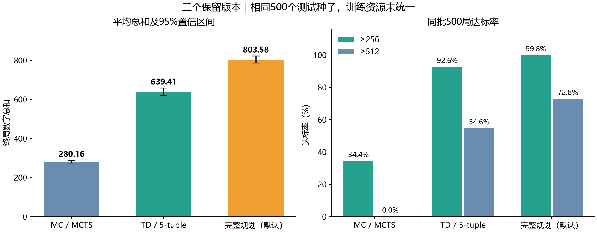

# 3×3 2048：MC、TD 与完整规划

保留三个自主游戏版本。棋盘3×3，初始两块，空格均匀生成2（90%）或4（10%）；达到256后继续，到无合法动作结束。目标是尽量增加终局数字总和，同时尽可能达到256。

## 结果

| 版本 | 方法 | 同批500局平均总和 | ≥256 | ≥512 |
|---|---|---:|---:|---:|
| `mc` | MCTS，128次模拟、深度12 | 280.164 | 34.4% | 0.0% |
| `td` | 乐观初始化、对称5-tuple TD，训练30万局 | 639.408 | 92.6% | 54.6% |
| `best`（默认） | 256概率优先＋完整总和规划 | 803.580 | 99.8% | 72.8% |



[完整58项榜单](docs/LEADERBOARD.md) · [精简实验报告与训练曲线](docs/REPORT.md) · [榜单CSV](docs/leaderboard.csv)

测试统一使用种子5000000–5000499，失败局也计入。训练资源未统一；推荐版本属于规划算法。默认规划另有独立10000局验证：平均总和812.9164，≥256为99.59%。随机环境中的达标率不是逐局保证。

## 运行

推荐Python 3.12。Windows PowerShell：

```powershell
python -m venv .venv
.\.venv\Scripts\python.exe -m pip install -e ".[test]"
.\.venv\Scripts\python.exe -m game2048.autoplay --agent best
```

双击 `play.bat` 选择版本，或使用 `play_mc.bat`、`play_td.bat`、`play_best.bat`。窗口中空格暂停，R开始新局，Esc退出。命令行将 `--agent` 改为 `mc` 或 `td` 即可切换；Linux/macOS使用对应虚拟环境的Python。

```powershell
# 无窗口运行／新种子评测
.\.venv\Scripts\python.exe -m game2048.autoplay --agent td --headless --games 10
.\.venv\Scripts\python.exe -m game2048.evaluate --games 100 --seed 6000000
# 各重放原500局，用固定指纹核验逐局结果
.\.venv\Scripts\python.exe -m game2048.evaluate --verify-retained
.\.venv\Scripts\python.exe -m pytest tests -q
```

## 方法与权重

- **MC**：[MCTS实现](game2048/wrappers/MCTS/fast.py)，逐步进行蒙特卡洛树搜索，无训练权重。
- **TD**：[一步后继状态策略](game2048/wrappers/TD/optimistic.py)与[训练入口](game2048/wrappers/TD/train_optimistic.py)。三个5格模式在8种棋盘对称下共享查表；TD(0)、折扣1，以新增数字值为奖励，不加256奖励。推理不叠加多层搜索。
- **完整规划**：[动作表查询](game2048/wrappers/Expectimax/tablebase.py)与[离线求解器](game2048/wrappers/Expectimax/solve_full.py)。达到256前优先最大化达标概率，以期望总和打破平局；之后最大化期望总和。运行只需加载已有动作表。

沿用 `game2048/wrappers/<方法>/models` 目录：TD的 `optimistic-5tuple-300k.npz`，规划的 `lex.npz` 和 `mass.npz`。配置、模型SHA256与评测指纹见 [selection.json](game2048/selection.json)。三个文件保持原权重，规划运行时动作表约224MiB，首次加载和编译需要数秒。

可选重训：`python -m game2048.wrappers.TD.train_optimistic`；完整重新求解：`python -m game2048.wrappers.Expectimax.solve_full`，后者需要约22GB基础数组及额外可用内存。结果默认写入 `results/`，不覆盖发布权重。

原仓库已有接口与文件保持兼容；当前默认入口只列三个保留版本。原 `python -m game2048.play` 为旧实验入口。当前三版本无需PyTorch或旧POSIX原生求解器。

许可：[MIT](LICENSE) · [MCTS来源](THIRD_PARTY_LICENSES.md)。
