# 3×3 2048：时序差分学习、蒙特卡洛树搜索与 PPO

## 目标与环境

默认棋盘为 3×3。主指标是**终局棋盘所有数字之和**，约束指标是最大方块是否达到至少 256。达到 256 后继续游戏，只有无合法移动才自然结束。每次有效移动随机生成 2（90%）或 4（10%）；环境单步奖励是新方块数值，整局奖励加初始总和等于终局总和。

`game2048/core.py` 提供确定性的移动/合并规则；`game2048/envs/game2048.py` 提供可设种子的 Gymnasium 环境及 Pygame 渲染。三种策略共用相同规则和评估入口：

| 路径 | 方法 | 是否训练 |
| --- | --- | --- |
| `game2048/wrappers/MCTS/agent.py` | 蒙特卡洛树搜索（MCTS） | 否，每步在线搜索 |
| `game2048/wrappers/TD/agent.py` | 后继状态 TD(0) + n-tuple 价值函数 | 是，模型可保存与继续训练 |
| `game2048/wrappers/ppo/` | 合法动作屏蔽的近端策略优化（PPO） | 是，模型可保存与继续训练 |
| `game2048/play.py` | 统一 `train/eval/watch/plot` 命令入口 | — |

## 安装

```bash
uv sync
```

PPO 使用可选的 PyTorch 和 SB3-Contrib 依赖；运行 PPO 命令前执行 `uv sync --extra ppo`。

## MCTS

每次真实决策建立一棵树。节点是随机方块生成后的棋盘，边是合法移动；选择阶段使用 UCT：

`平均模拟价值 + c × sqrt(ln(父节点访问次数 + 1) / 动作访问次数)`。

尚未访问的动作按局面启发式优先展开，然后按真实规则随机生成新方块；树外用启发式与少量随机动作完成 rollout，最后把叶节点估值回传到经过的动作。叶节点启发式包含棋盘总和、空格数、八种角落蛇形排列的最大加权和，以及达到 256 的搜索奖励；无合法动作时扣除生存惩罚。最终选择根节点平均价值最高的动作。MCTS 与原先“每个候选动作独立做固定次数 rollout”的实现不同，它会把模拟预算分配给树中的动作。

默认参数：每步 `simulations=128`、`depth=12`、UCT 常数 `exploration=70`、rollout 随机动作概率 `rollout_random=0.15`、空格权重 18、蛇形权重 1、达标搜索奖励 256。更多模拟或更深搜索通常增加计算量；UCT 常数决定探索尚不确定动作的力度。这些数值是可运行基线，不是经过全局寻优的最优参数。

## TD(0) 训练

后继状态是移动/合并后、随机生成方块前的棋盘 `z`。TD 智能体学习 `V(z)`，作为该行动之后终局效用的估计。效用定义为终局棋盘总和，加上“曾达到 256”时的一次性 256 奖励。普通相邻后继状态使用

`V(z_t) ← V(z_t) + α [V(z_{t+1}) − V(z_t)]`；

终局时把目标改为实际终局效用。价值函数由空格与蛇形启发式先验加上可学习的 n-tuple 权重组成。n-tuple 包括 3 行、3 列和 4 个 2×2 方块；棋盘先经旋转/镜像归一化，让对称局面共享权重。训练采用 ε-greedy：ε 从 0.20 在前 1000 局线性降到 0.02，学习率 `α=0.2`。已有模型放在 `game2048/wrappers/TD/models/td-3x3.pkl`，评估和演示自动加载；`--resume` 可接着训练。

训练阶段的图展示逐局终局总和、50 局移动平均、最大块、累计达标率和平均绝对 TD 误差。TD 误差不是监督学习的“损失”，随着可达到的棋盘总和变大，其绝对量也可能上升。

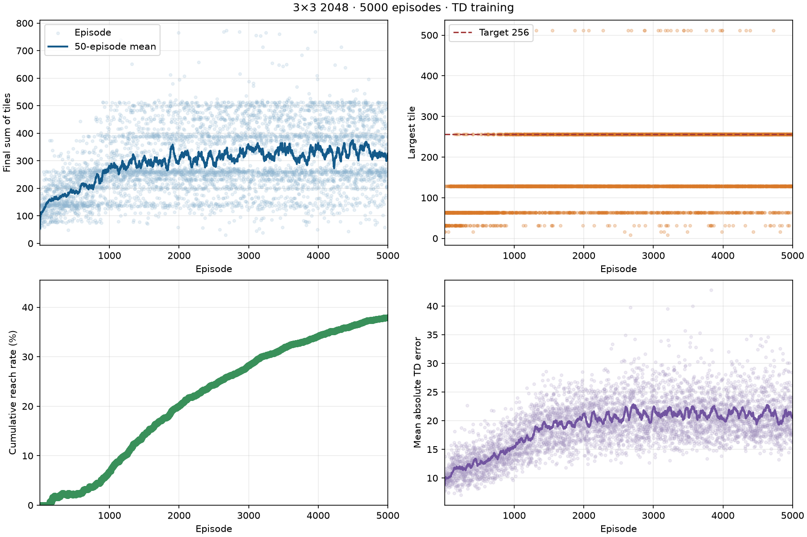

### TD 调优调研（默认模型未改动）

现有 TD 模型采用一步贪心后继状态估值，已训练 5000 局；学习率始终是 `α=0.2`，特征为 3 个行、3 个列与 4 个 2×2 方块。对照 [Szubert 与 Jaśkowski 的后继状态 TD/n-tuple 研究](https://mszubert.github.io/papers/Szubert_2014_CIG.pdf)，这里仍有训练时长、学习率与特征结构可调。[Jaśkowski 的后续研究](https://arxiv.org/html/1604.05085)验证了自适应学习率、冗余特征及 expectimax 搜索的作用；[Guei 等人的研究](https://arxiv.org/pdf/2111.11090)提出乐观初始化来改善探索。这些论文主要研究 4×4 和传统合并得分，不能把论文中的参数或得分直接搬到本项目。

为检验最容易落地的方向，从默认 TD 模型复制三个临时模型，分别以 `α=0.2/0.05/0.02`、相同的种子 12000–12999 续训 1000 局；其他训练参数不变。另用原模型或 `α=0.02` 续训模型做一步随机生成方块 + 下一步行动的 expectimax 搜索：枚举所有空位及生成 2/4 的概率，以 TD 估值作叶节点，终局直接用实际终局效用。验证集为 8000–8099，测试集为 10000–10099，均未参与训练；每组 100 局，自然结束。

| TD 决策方式 | 验证集平均总和 / 达标 | 测试集平均总和 / 达标 |
| --- | ---: | ---: |
| 默认模型，一步贪心 | 392.66 / 71% | 385.50 / 72% |
| 原学习率 0.2，续训 1000 局 | 386.66 / 74% | 374.08 / 68% |
| 学习率 0.05，续训 1000 局 | 413.14 / 77% | 393.94 / 66% |
| 学习率 0.02，续训 1000 局 | 420.50 / 77% | 426.66 / 80% |
| 默认模型 + expectimax | 470.90 / 92% | 441.88 / 80% |
| 0.02 续训模型 + expectimax | **485.10 / 90%** | **475.80 / 83%** |

组合方案比默认模型在这 100 个测试种子上平均高 90.30；按种子配对重采样的 95% 区间约为 +56.7 至 +124.8。达标率从 72% 到 83%，但 100 局对这项差异仍不够精确。expectimax 的测试运行约 17 秒/100 局；一步贪心 CLI 评估约 3 秒/100 局，两者运行方式不同，仅说明搜索会增加计算成本。这是有限预算的探索性结果，默认模型及正式对照表仍使用原始一步贪心版本。

目前 `--resume` 会加载模型中保存的配置，因此同时传入 `--alpha` **不会**改变续训学习率；本次实验先在模型副本中修改保存的配置，再分别续训。正式加入调参命令前应修正这一入口行为。下一步可将 expectimax 作为可选推理参数集成，并用更长训练预算比较较小学习率、5/6 格 n-tuple、按方块大小分阶段的价值函数与乐观初始化。[3×3 版本已有完全求解研究及实现](https://github.com/shuymst/solving_2048_on_3x3_board/blob/master/README.md)，以后还能用最优策略作为参照；该实现优化的是传统合并得分，需先适配本项目的终局总和目标。

## PPO 方案与参考项目

参考 [rgal/gym-2048 的 PPO 训练脚本](https://github.com/rgal/gym-2048/blob/b6ffbba3002d53c75312b47a535da7fd6bc3a41f/ppo_train.py) 与 [环境实现](https://github.com/rgal/gym-2048/blob/b6ffbba3002d53c75312b47a535da7fd6bc3a41f/env/envs/game2048_env.py)：使用方块指数的独热表示、残差 CNN 特征提取器以及 SB3 系列的 PPO。该项目还有[独立的行为克隆预训练脚本](https://github.com/rgal/gym-2048/blob/b6ffbba3002d53c75312b47a535da7fd6bc3a41f/pretrain_bc.py)，可先模仿数据再做 PPO 更新。这里的“PPO”指策略优化算法，CNN 是其策略/价值网络的特征提取部分。参考项目默认是 4×4、以合并分数为奖励，非法动作直接终止，且可在达到指定方块时结束。本项目适配为 3×3、16×3×3 独热张量，使用当前环境的动作编号；达到 256 后继续，直到无合法动作才结束。

PPO 使用 [SB3-Contrib 的 MaskablePPO](https://sb3-contrib.readthedocs.io/en/master/modules/ppo_mask.html) 屏蔽无效动作。每步奖励为新方块数值的 1/4；第一次达到 256 额外奖励 64。若不考虑折扣，`4 × 累计 PPO 奖励 + 初始数字和 = 终局数字和 + 256 × 是否达标`。网络通过 `CnnPolicy` 使用残差 CNN，默认 64 个卷积通道、4 个残差块、64 维特征。`--separate-features` 为策略和价值函数分别建立 CNN。可选的 `--bc-episodes` 会先用项目已有 TD 策略生成棋局数据，做行为克隆后再执行 PPO，因此这种模型同时利用了 TD 教师，不能算独立的从零训练 PPO。

默认训练参数：4 个环境、每个环境每轮 256 步、批次 128、每轮 4 次更新、学习率 3e-4、`gamma=0.995`、`GAE λ=0.95`、PPO 裁剪范围 0.2、熵系数 0.01。实际随项目提供的 PPO 模型使用单独的策略/价值 CNN、学习率 1e-4、`gamma=0.999`，并先完成 500 局 TD 教师模仿、12 轮行为克隆，再进行 50,176 个 PPO 环境步更新。教师数据有 84,624 个棋盘/动作样本；行为克隆最后一轮在这些训练样本上的动作准确率为 91.06%。训练步数和这些参数可由统一入口指定。折扣因子小于 1 会偏好较早得到奖励，因此训练目标是终局总和的近似代理。

PPO 训练日志逐局记录终局总和、最大块、步数、达标情况，同时记录 PPO 更新诊断（如策略损失、价值损失与熵）。下图展示所提供模型的 50 局移动平均、累计达标率等训练指标；这 50,176 步内完成 626 局，平均终局总和为 180.43，达标率 10.1%。训练过程中按当前策略采样，因此曲线和固定种子的贪心评估数值不能直接等同。

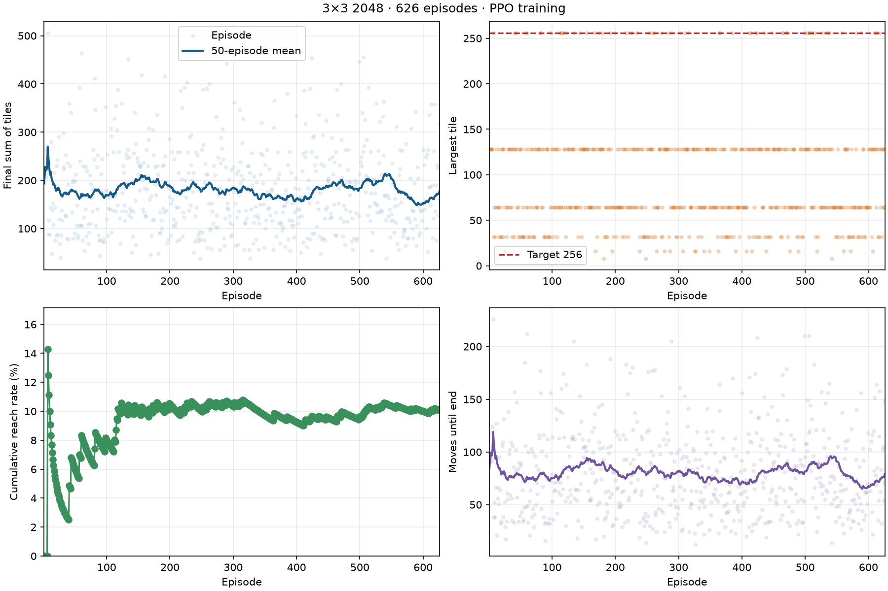

超参数试验在种子 8000–8019 的 20 局验证集上比较：

| 方案 | 训练量 | 平均终局总和 | 达到 256 |
| --- | ---: | ---: | ---: |
| 16 通道、1 残差块，从零训练 | 约 200 万 PPO 步 | 151.6 | 0/20 |
| 64 通道、4 残差块，从零训练 | 约 50 万 PPO 步 | 121.7 | 0/20 |
| 独立 CNN、TD 行为克隆，尚未 PPO 更新 | 500 局教师数据、12 轮 | 190.0 | 3/20 |
| 独立 CNN、TD 行为克隆 + PPO | 上述预训练 + 50,176 步 | 207.3 | 4/20 |
| 上述 PPO 再加 0.1 倍合并分数奖励 | 上述预训练 + 50,176 步 | 208.8 | 2/20 |

额外合并奖励在验证集上没有同时提高达标次数；共享策略/价值 CNN 的行为克隆在 PPO 更新后也出现明显退化。选择独立 CNN、保持原目标奖励的模型作为默认模型。验证集样本小，这些对比是调参记录，不构成某组超参数全局最优的证据。仅行为克隆模型与加入 PPO 更新后的模型分开列出，以免把教师策略收益误认为全部来自 PPO。

从零训练的较小 CNN 模型保留在 `game2048/wrappers/ppo/models/ppo-3x3-small-cnn-2m.zip`。默认模型和行为克隆结束、尚未 PPO 更新的检查点分别是 `ppo-3x3.zip` 与 `ppo-3x3-cnn64-separate-tdwarm-bc.zip`。

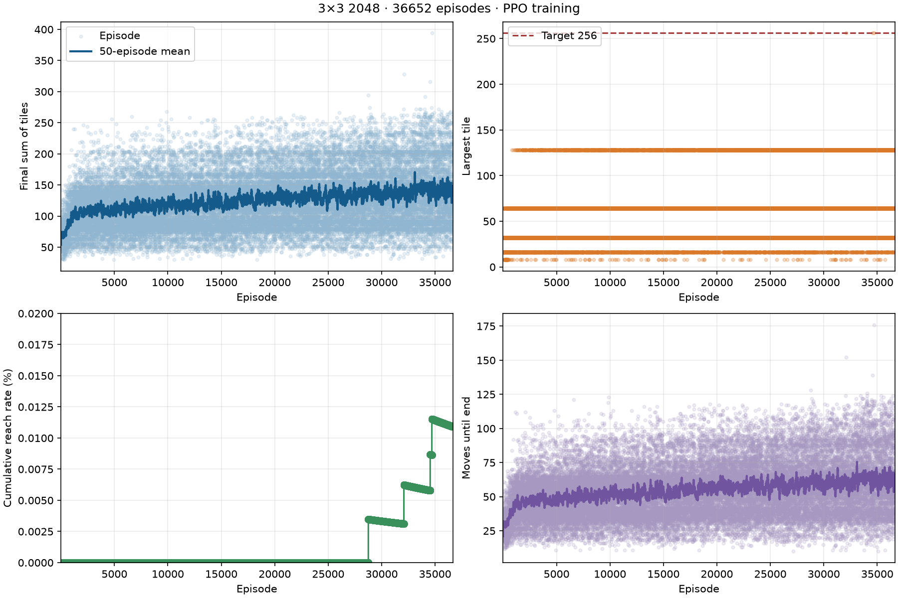

## 实测结果

TD 模型先训练 1000 局（环境种子 2026–3025），再从同一模型继续训练 4000 局（种子 3026–7025）。训练前 500 局的平均终局总和为 164.13、达标率 2.2%；最后 500 局分别为 330.41、51.8%。最终模型含 15,279 个已学习的特征权重。

训练完成后，对所有策略使用相同的 20 个环境种子 10000–10019 评估；这些种子没有参与 TD 训练、PPO 行为克隆或 PPO 更新。PPO 的模型选择只使用了另外的验证种子 8000–8019：

| 策略 | 平均终局总和 | 中位总和 | 最高总和 | 达到 256 | 平均步数 |
| --- | ---: | ---: | ---: | ---: | ---: |
| 随机合法动作 | 76.3 | 79 | 120 | 0/20 | 33.10 |
| MCTS（128 次模拟、深度 12） | 266.0 | 259 | 466 | 6/20 | 119.45 |
| TD（训练 5000 局后，贪心评估） | 384.0 | 385 | 514 | 14/20 | 172.15 |
| CNN + TD 行为克隆 + PPO（50,176 步） | 211.4 | 226 | 508 | 2/20 | 94.55 |

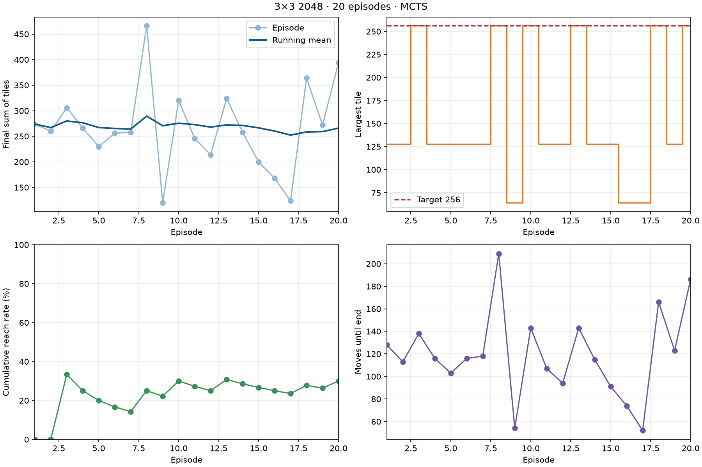

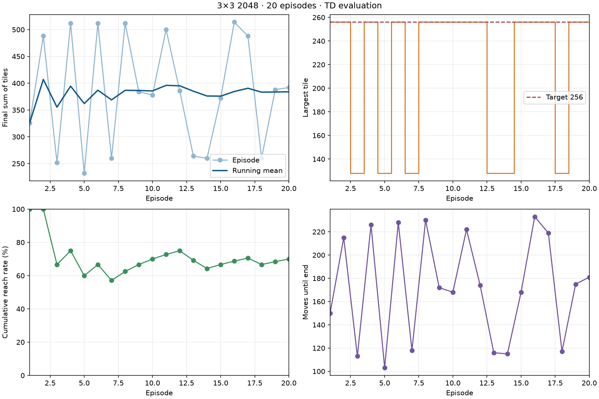

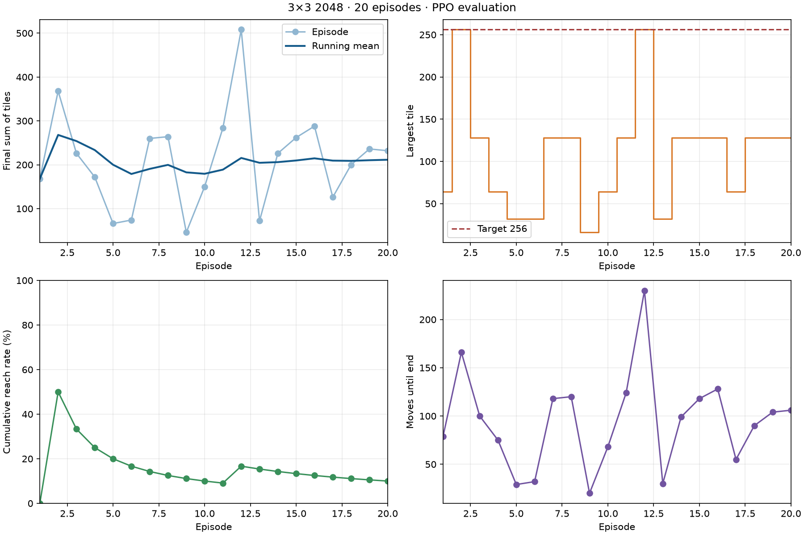

20 局均因没有合法移动而自然结束。扩大到种子 10000–10099 的 100 局，所提供 PPO 模型平均终局总和为 215.36，18/100 局达到 256；这 100 局包含上表的 20 局。前面从零训练的 16 通道 PPO 模型在相同 100 个种子上的平均总和为 161.6，0/100 局达标。PPO 在当前训练预算下弱于 TD 与 MCTS；尤其所提供 PPO 模型利用了 TD 教师，不能把它当作与 TD 完全独立的方法比较。20 个种子不足以证明任一方法最优，且各策略的单步计算成本不同。

## 统一命令与日志

```bash
# MCTS 评估
uv run game2048-play --algorithm mcts --mode eval --episodes 20 --seed 10000 --plot docs/mcts-evaluation-curve.png

# 直接评估内置 TD 模型（无需指定路径）
uv run game2048-play --algorithm td --mode eval --episodes 20 --seed 10000 --plot docs/td-evaluation-curve.png

# 从零训练、续训自己的 TD 模型
uv run game2048-play --algorithm td --mode train --episodes 1000 --seed 2026 --model models/td-reproduction.pkl
uv run game2048-play --algorithm td --mode train --resume --episodes 4000 --seed 3026 --model models/td-reproduction.pkl

# 从两次训练日志合成完整训练曲线
uv run game2048-play --algorithm td --mode plot --logs log/game2048-td-train-20261025T125017324206Z-83294.log log/game2048-td-train-20261025T125204183436Z-84789.log --plot docs/td-training-curve.png

# PPO 可选依赖、复现所提供的 CNN + 行为克隆 + PPO 模型
uv sync --extra ppo
uv run --extra ppo game2048-play --algorithm ppo --mode train --timesteps 50000 --seed 2026 --bc-episodes 500 --bc-epochs 12 --separate-features --gamma 0.999 --learning-rate 0.0001 --model game2048/wrappers/ppo/models/my-ppo.zip --plot docs/my-ppo-training-curve.png
uv run --extra ppo game2048-play --algorithm ppo --mode eval --episodes 20 --seed 10000 --plot docs/ppo-evaluation-curve.png
uv run --extra ppo game2048-play --algorithm ppo --mode watch --seed 10011
```

训练、评估和演示在 `log/` 创建时间戳命名的 `.log` 文件；`plot` 模式从已有日志生成图像。评估与演示逐步记录动作、奖励、棋盘总和、最大块与结束原因；TD 训练记录 ε、平均绝对 TD 误差及特征数，PPO 训练另记行为克隆指标和 PPO 更新诊断。终端输出实际日志和图像路径。默认无步数上限；`--max-steps N` 才会截断并将原因标为 `max_steps`。

## Pygame 可视化

```bash
uv run game2048-play --algorithm mcts --mode watch --seed 5001
uv run game2048-play --algorithm td --mode watch --seed 5001
uv run --extra ppo game2048-play --algorithm ppo --mode watch --seed 10011
```

在无桌面的环境可设置 `SDL_VIDEODRIVER=dummy SDL_AUDIODRIVER=dummy`，并用 `--screenshot docs/td-demo.png` 保存终局。实际可视化运行中，MCTS 在第 123 步达到 256、再走 76 步，以总和 436 自然结束；TD 在第 120 步达到 256、再走 104 步，以总和 508 自然结束。PPO 的示例选用种子 10011，在第 126 步达到 256 后又走 104 步，以总和 508 自然结束。

下列轨迹记录了各演示局到自然终局的过程；PPO 种子 10011 同时属于评估集，上表已经计入该局。

| MCTS | TD | PPO |
|---|---|---|
| 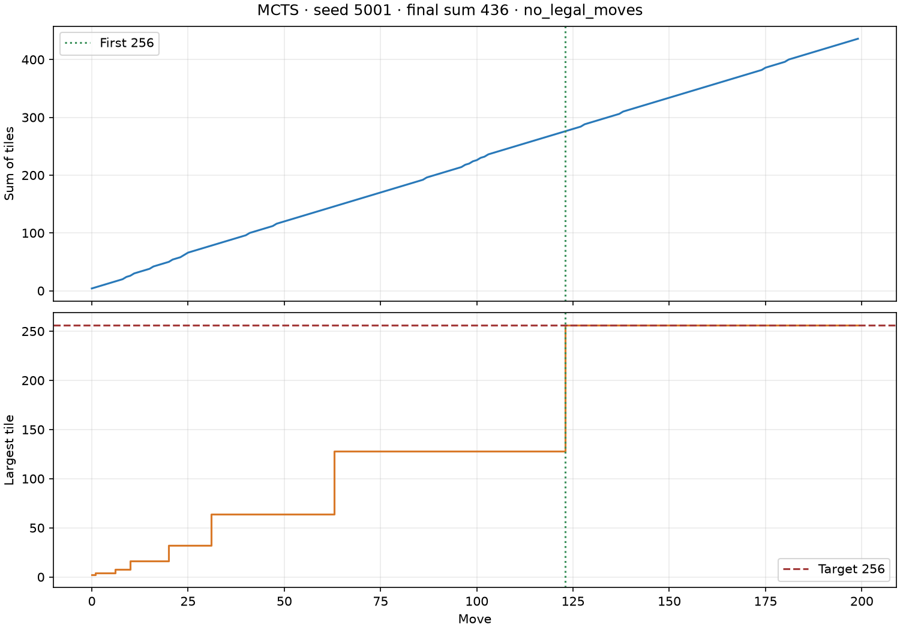 | 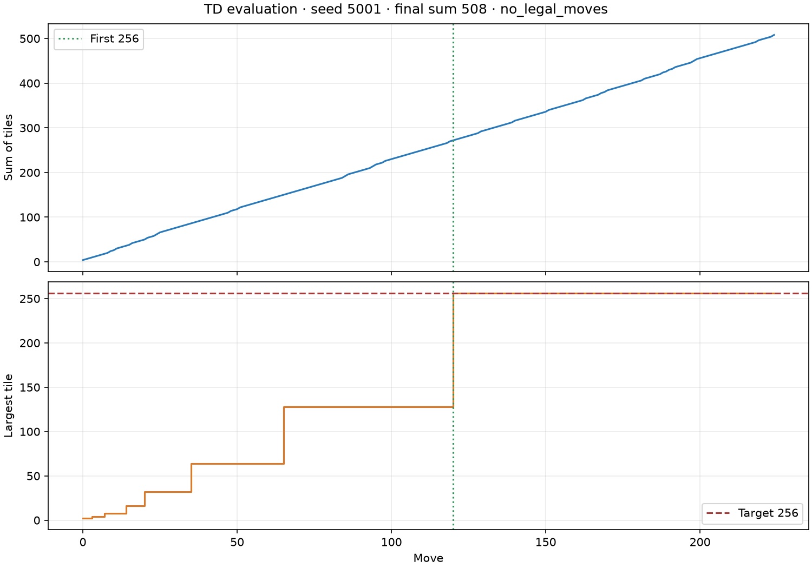 | 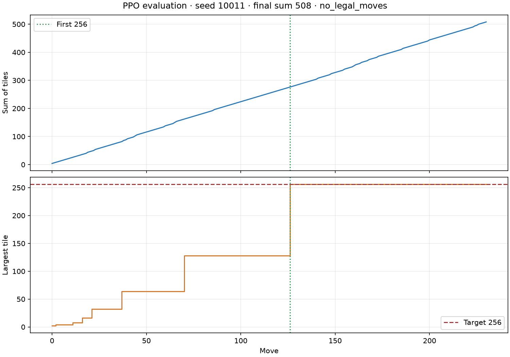 |
| 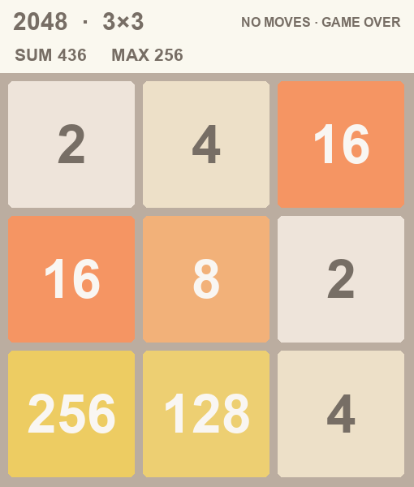 | 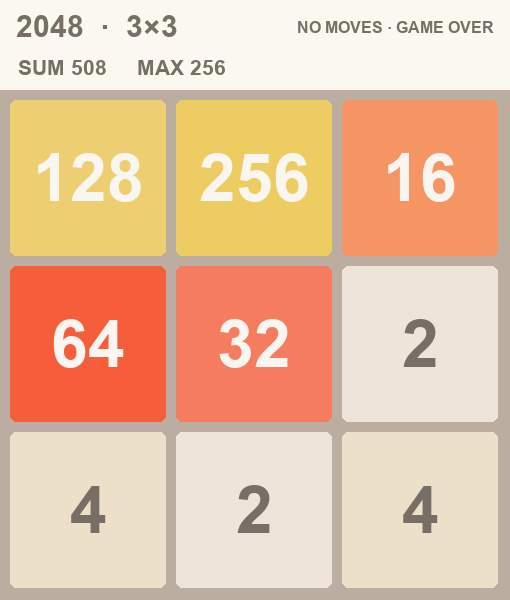 | 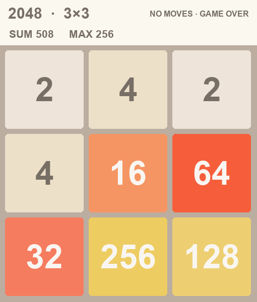 |

## 验证与局限

`uv run --extra ppo python -m unittest discover -s game2048/tests -v` 验证移动规则、环境种子与奖励、达到 256 后继续、MCTS 合法动作、TD 更新及模型读写、PPO 棋盘编码、动作屏蔽、CNN 训练/加载，以及统一入口和日志图像输出。这里的“总和”不是传统 2048 按合并值累计的分数；结论仅适用于当前 3×3 目标和上述超参数。
