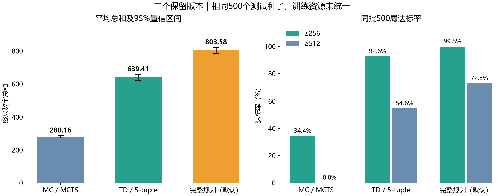
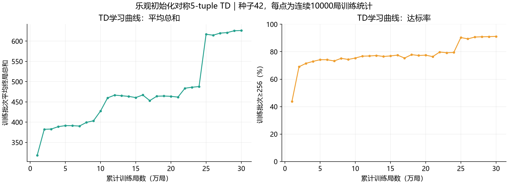
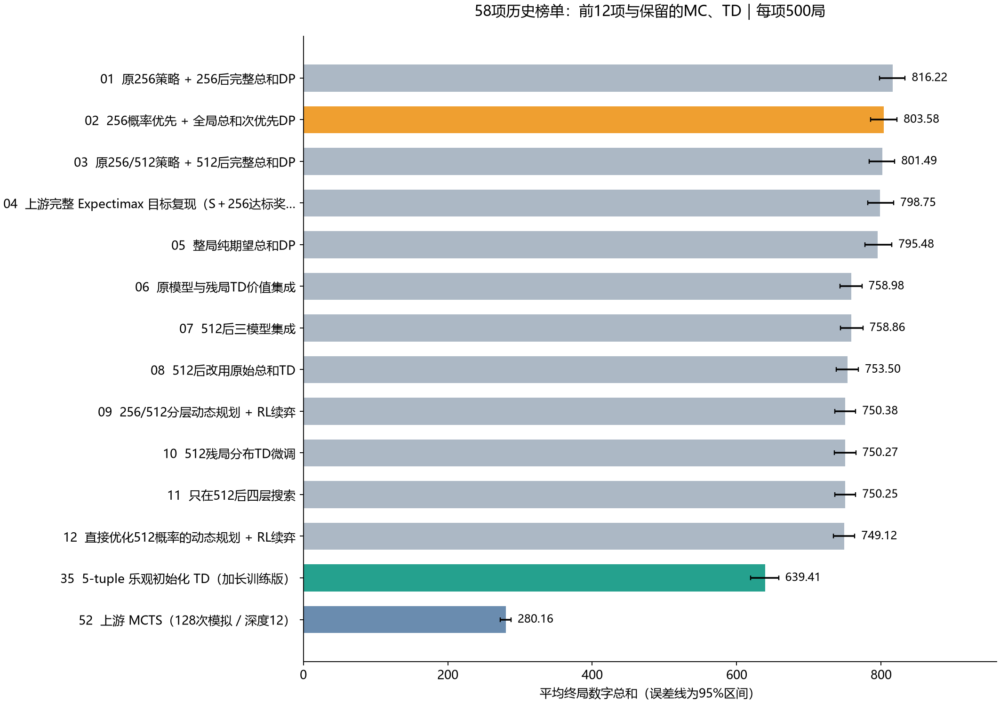

# 3×3 2048 精简实验报告

## 评测协议

棋盘3×3，初始两块，2/4生成概率0.9/0.1；达到256后继续，至无合法动作。统计终局九格数字总和、≥256及≥512比例，所有失败局计入，4096步上限未触发。

完整历史榜单包含58项固定策略／训练对照，每项500局，共29000局，统一种子5000000–5000499。评测器提前生成每局落块随机数带，策略随机流与环境独立；不同动作改变空格布局，相同随机输入不保证实际落块坐标相同。

## 最终保留版本

| 版本 | 平均总和（95%区间） | ≥256 | ≥512 | 离线预算／在线预算 |
|---|---:|---:|---:|---|
| MC | 280.164 [272.53, 287.64] | 34.4% | 0.0% | 无训练；每步128次模拟、深度12 |
| TD | 639.408 [619.56, 658.11] | 92.6% | 54.6% | CPU训练30万局；一步后继状态查表 |
| 完整规划 | 803.580 [785.43, 822.05] | 99.8% | 72.8% | CPU完整动态规划；在线动作表查询 |

MC保留原仓库MCTS配置并作Numba移植。TD按终局总和保留纯TD检查点。完整规划保留已冻结、完成独立万局验证的46号；榜首45号在500局中均值816.22，45减46的配对差为12.64，95%区间[-3.42,29.22]，不足以据此改换默认策略。

默认规划在独立种子2000000–2009999的10000局中，平均总和812.9164，95%区间[808.81,816.95]；≥256为99.59%，≥512为74.02%。这批结果与共同500局分开报告。

## TD训练与规划计算

TD使用三个基础5格模式及D4对称共享，初始总估值约300，TD(0)、折扣1。目标更新为 `新增数字值 + 下一后继状态价值`，终局后续价值为0，不加目标奖励；特征重复时按平方范数归一化。每10000局为一批，批种子为 `42+已完成局数`。学习率前70%为0.1、之后0.03；探索率前80%为0.02、之后0.002。

曲线每点对应连续10000局训练统计，含探索动作，不是独立测试成绩。原训练记录耗时约64.3秒；计时受硬件、JIT与缓存影响。

完整规划在256前最大化达标概率，再以期望总和打破数值平局；达标后只优化总和。使用float64、概率容差1e-12及总和容差1e-10，无学习边界估值。原记录约3.889亿总和状态、4868万达标前状态，求解分别约274.9秒、57.7秒，压缩另计。重新求解需约22GB基础数组；已有压缩动作表可直接运行。结果没有附形式化最优性证明。

## 完整榜单与局限

[查看全部58项](LEADERBOARD.md) · [CSV](leaderboard.csv)

58项为45个去重配置、5个加长训练对照、2个训练种子对照、6个仓库基线，不是58种独立算法。仓库基线固定提交 `fc62be0aeb8a660a996cca54f517d119d817fbe7`。

统一的是测试规则、种子和局数，训练局数、交互步数、计算及推理预算未完全控制一致。后续资源统一补充实验已按用户要求取消，PPO未完成，未据此生成完整新榜单或替换模型。多轮探索存在选择偏差；万局验证只比较当时冻结的默认规划与旧冠军。

发布前已通过11项当前版本测试，并各重放500局逐局匹配原结果；精简后用六列逐局结果的固定SHA256保留核验能力，无需提交原始CSV。模型权重SHA256不变。原仓库旧测试集在Windows因 `fcntl` 依赖无法完整收集，当前三个版本不依赖该模块。
