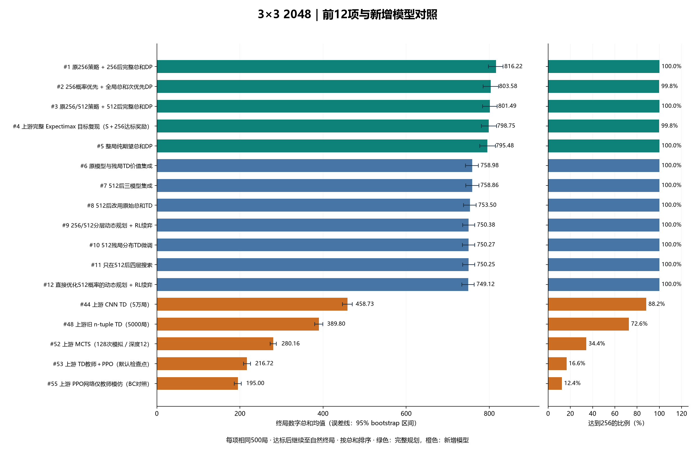

# 3×3 2048 完整统一榜单

**58项固定策略，每项500局，共29,000局；全部使用同一批全新随机种子5000000–5000499。**

按终局棋盘九个数字的总和均值降序。256达标率独立列出；所有失败局均计入总和，达到256或512后继续，到无合法动作结束。本批没有非法动作或步数截断。

本批第一名是45号“原256规划＋256后完整总和DP”，平均816.22；此前默认46号“256概率优先＋完整总和DP”为803.58，排名第二。500局的细微名次受采样影响：45减46的配对均值差为12.64，95%区间[-3.42, 29.22]。因此本次不据此改换已冻结的默认策略。

新增三类主方法来自[用户提供的仓库](https://github.com/riyuexingchennnn/game2048)，固定版本[`fc62be0aeb8a`](https://github.com/riyuexingchennnn/game2048/commit/fc62be0aeb8a660a996cca54f517d119d817fbe7)。使用随仓库提供的权重，没有重新训练或按本批结果调参。

| 新增主要方法 | 总榜名次 | 平均总和 | ≥256 | ≥512 |
|---|---:|---:|---:|---:|
| 上游 CNN TD（5万局） | 44 | 458.73 | 88.2% | 13.2% |
| 上游 MCTS（128次模拟／深度12） | 52 | 280.16 | 34.4% | 0.0% |
| 上游 TD教师＋PPO（默认检查点） | 53 | 216.72 | 16.6% | 0.0% |



## 完整58项榜单

“第一轮”包含16个初始配置与阶段切换配置；另列5个加长训练版本和2个训练种子对照。第二轮18号就是第一轮17号，最后一轮34号就是第二轮32号，合并别名，避免重复占位。三轮45个配置＋7个训练对照＋6个新增条目＝58项；这不是58种独立算法。

| 排名 | 方法 | 来源批次 | 类型 | 平均总和（95%区间） | ≥256 | ≥512 | 1024局数 |
|---:|---|---|---|---:|---:|---:|---:|
| 1 | 原256策略 + 256后完整总和DP | 最后一轮 | 完整规划 | 816.22 [798.12, 833.30] | 100.0% | 74.8% | 5 |
| 2 | 256概率优先 + 全局总和次优先DP | 最后一轮 | 完整规划 | 803.58 [785.43, 822.05] | 99.8% | 72.8% | 5 |
| 3 | 原256/512策略 + 512后完整总和DP | 最后一轮 | 完整规划 | 801.49 [783.49, 818.84] | 100.0% | 73.0% | 4 |
| 4 | 上游完整 Expectimax 目标复现（S＋256达标奖励） | 新增仓库 | 完整规划 | 798.75 [781.27, 817.41] | 99.8% | 71.4% | 4 |
| 5 | 整局纯期望总和DP | 最后一轮 | 完整规划 | 795.48 [777.35, 814.85] | 100.0% | 70.6% | 3 |
| 6 | 原模型与残局TD价值集成 | 最后一轮 | 规划＋学习 | 758.98 [743.01, 773.44] | 100.0% | 73.0% | 0 |
| 7 | 512后三模型集成 | 最后一轮 | 规划＋学习 | 758.86 [743.66, 774.79] | 100.0% | 73.0% | 0 |
| 8 | 512后改用原始总和TD | 最后一轮 | 规划＋学习 | 753.50 [738.04, 768.57] | 100.0% | 73.0% | 0 |
| 9 | 256/512分层动态规划 + RL续弈 | 第二轮 | 规划＋学习 | 750.38 [735.63, 764.78] | 100.0% | 73.0% | 0 |
| 10 | 512残局分布TD微调 | 最后一轮 | 规划＋学习 | 750.27 [735.20, 764.93] | 100.0% | 73.0% | 0 |
| 11 | 只在512后四层搜索 | 最后一轮 | 规划＋学习 | 750.25 [735.77, 764.83] | 100.0% | 73.0% | 0 |
| 12 | 直接优化512概率的动态规划 + RL续弈 | 第二轮 | 规划＋学习 | 749.12 [734.00, 763.56] | 100.0% | 72.6% | 0 |
| 13 | 512残局分布TC微调 | 最后一轮 | 规划＋学习 | 746.57 [731.53, 761.70] | 100.0% | 73.0% | 0 |
| 14 | 512后低探索率续训TD | 最后一轮 | 规划＋学习 | 744.69 [730.37, 759.33] | 100.0% | 73.0% | 0 |
| 15 | 512后乐观续训TD | 最后一轮 | 规划＋学习 | 742.27 [727.67, 756.60] | 100.0% | 73.0% | 0 |
| 16 | 512后全局TC模型 | 最后一轮 | 规划＋学习 | 727.06 [713.39, 740.86] | 100.0% | 73.0% | 0 |
| 17 | 256动态规划 + 集成RL续弈 | 第二轮 | 规划＋学习 | 725.66 [710.03, 742.99] | 100.0% | 67.4% | 0 |
| 18 | 256动态规划 + 原总和RL续弈 | 第二轮 | 规划＋学习 | 721.70 [704.19, 738.23] | 100.0% | 66.0% | 0 |
| 19 | 256动态规划 + 验证最佳总和RL续弈 | 第二轮 | 规划＋学习 | 718.00 [702.42, 734.02] | 100.0% | 67.4% | 0 |
| 20 | 验证集最佳 TD + Expectimax 深度3 | 第一轮 | 学习＋搜索 | 717.05 [698.02, 736.19] | 96.0% | 64.2% | 0 |
| 21 | 四层Expectimax搜索 | 第二轮 | 学习＋搜索 | 716.22 [697.53, 734.87] | 95.8% | 66.0% | 0 |
| 22 | 三个续训模型的价值集成 | 第二轮 | 学习＋搜索 | 713.18 [695.08, 731.90] | 96.4% | 63.8% | 0 |
| 23 | 5%最差结果混合的风险搜索 | 第二轮 | 学习＋搜索 | 705.74 [687.28, 723.42] | 95.4% | 64.2% | 0 |
| 24 | 无随机动作TD续训 | 第二轮 | 学习＋搜索 | 704.07 [686.53, 720.96] | 96.6% | 64.6% | 0 |
| 25 | 空格驱动的2/4层自适应搜索 | 第二轮 | 学习＋搜索 | 703.57 [685.58, 721.09] | 96.4% | 64.2% | 0 |
| 26 | 验证集最佳 TD + Expectimax 深度3（加长训练版） | 加长训练 | 学习＋搜索 | 701.16 [682.84, 718.46] | 95.8% | 63.8% | 0 |
| 27 | 分阶段双模型 TD + 深度3搜索 | 第一轮 | 学习＋搜索 | 700.96 [682.44, 719.65] | 95.8% | 63.6% | 0 |
| 28 | 低探索率TD续训 | 第二轮 | 学习＋搜索 | 700.39 [681.92, 717.97] | 96.4% | 64.0% | 0 |
| 29 | 乐观模型低探索率续训 | 第二轮 | 学习＋搜索 | 696.00 [677.84, 714.05] | 96.4% | 62.8% | 0 |
| 30 | 成功概率TD头 + 总和TD续弈 | 第二轮 | 学习＋搜索 | 691.96 [673.15, 710.67] | 95.6% | 63.0% | 0 |
| 31 | 逐权重时间一致性TD续训 | 第二轮 | 学习＋搜索 | 688.95 [670.87, 704.60] | 96.2% | 64.0% | 0 |
| 32 | 低探索率平缓退火从头训练 | 第二轮 | 学习＋搜索 | 681.17 [664.62, 697.54] | 96.2% | 63.2% | 0 |
| 33 | 验证集最佳 TD + Expectimax 深度2 | 第一轮 | 学习＋搜索 | 670.01 [651.05, 689.44] | 94.6% | 55.6% | 0 |
| 34 | 验证集最佳 TD + Expectimax 深度2（加长训练版） | 加长训练 | 学习＋搜索 | 666.85 [648.51, 684.85] | 94.6% | 58.2% | 0 |
| 35 | 5-tuple 乐观初始化 TD（加长训练版） | 加长训练 | 强化学习 | 639.41 [619.56, 658.11] | 92.6% | 54.6% | 0 |
| 36 | 5-tuple 对称 TD(0) 总和奖励（加长训练版） | 加长训练 | 强化学习 | 621.50 [600.89, 639.60] | 91.2% | 52.2% | 0 |
| 37 | 5-tuple TD 传统合并分奖励 | 第一轮 | 强化学习 | 620.78 [601.04, 640.27] | 91.8% | 51.8% | 0 |
| 38 | 5-tuple 对称 TD(0) 总和奖励 | 第一轮 | 强化学习 | 609.22 [588.99, 628.72] | 89.4% | 48.6% | 0 |
| 39 | 5-tuple TD 总和+首次256奖励（加长训练版） | 加长训练 | 强化学习 | 608.88 [591.46, 625.72] | 91.0% | 50.6% | 0 |
| 40 | 5-tuple 离线 TD(lambda=0.5) | 第一轮 | 强化学习 | 583.09 [562.59, 602.98] | 85.2% | 48.2% | 0 |
| 41 | 5-tuple 乐观初始化 TD | 第一轮 | 强化学习 | 541.98 [527.93, 557.12] | 91.4% | 28.2% | 0 |
| 42 | 5-tuple 对称 TD(0) 总和奖励（训练种子123） | 种子123 | 强化学习 | 513.55 [491.10, 535.66] | 66.4% | 35.6% | 0 |
| 43 | 5-tuple TD 总和+首次256奖励 | 第一轮 | 强化学习 | 476.71 [465.46, 487.23] | 89.8% | 12.6% | 0 |
| 44 | 上游 CNN TD（5万局） | 新增仓库 | 强化学习 | 458.73 [446.97, 470.12] | 88.2% | 13.2% | 0 |
| 45 | 5-tuple 对称 TD(0) 总和奖励（训练种子456） | 种子456 | 强化学习 | 452.26 [430.93, 474.73] | 57.4% | 27.4% | 0 |
| 46 | 4-tuple 对称 TD(0) 总和奖励 | 第一轮 | 强化学习 | 427.00 [411.26, 442.48] | 74.0% | 15.2% | 0 |
| 47 | 5-tuple TD(0) 无对称共享 | 第一轮 | 强化学习 | 410.65 [397.43, 424.36] | 75.0% | 6.6% | 0 |
| 48 | 上游旧 n-tuple TD（5000局） | 新增仓库 | 强化学习 | 389.80 [380.12, 399.40] | 72.6% | 2.0% | 0 |
| 49 | 6-tuple 对称 TD 总和+首次256奖励 | 第一轮 | 强化学习 | 388.91 [374.02, 404.04] | 61.6% | 17.6% | 0 |
| 50 | 启发式 Expectimax 深度2 | 第一轮 | 基线／搜索 | 314.26 [305.01, 323.37] | 40.6% | 1.0% | 0 |
| 51 | 蒙特卡洛启发式 Rollout | 第一轮 | 基线／搜索 | 296.37 [285.01, 308.01] | 34.6% | 2.4% | 0 |
| 52 | 上游 MCTS（128次模拟／深度12） | 新增仓库 | 基线／搜索 | 280.16 [272.53, 287.64] | 34.4% | 0.0% | 0 |
| 53 | 上游 TD教师＋PPO（默认检查点） | 新增仓库 | 强化学习 | 216.72 [208.50, 225.41] | 16.6% | 0.0% | 0 |
| 54 | 蛇形与单调性启发式 | 第一轮 | 基线／搜索 | 215.88 [209.16, 222.70] | 9.6% | 0.0% | 0 |
| 55 | 上游 PPO网络仅教师模仿（BC对照） | 新增仓库 | 教师模仿 | 195.00 [186.49, 203.48] | 12.4% | 0.0% | 0 |
| 56 | 即时合并分贪心 | 第一轮 | 基线／搜索 | 114.21 [111.11, 117.51] | 0.0% | 0.0% | 0 |
| 57 | 空格优先贪心 | 第一轮 | 基线／搜索 | 114.20 [111.05, 117.45] | 0.0% | 0.0% | 0 |
| 58 | 随机合法动作 | 第一轮 | 基线／搜索 | 69.24 [67.55, 71.02] | 0.0% | 0.0% | 0 |

## 接入与可比性

- MCTS：128次模拟、深度12，保留原启发式、UCT、随机回放和随机数调用顺序。数值加速版本经过动作及完整随机数状态对照。
- CNN TD：仓库默认79,874参数检查点，自我对弈50,000局，无教师；使用原11通道编码、后继状态基线和贪心选择。
- PPO：主条目使用实际默认的`ppo-3x3.zip`，包括500局TD教师数据、12轮模仿预训练与50,176个PPO环境步。仅模仿的`*-bc.zip`另列“BC对照”，不能混称为继续训练后的PPO。
- 旧n-tuple TD：仓库保存的5000局模型，也作为补充对照列入。
- 完整Expectimax：上游目标为`U=S+256×I(达到256)`。原生加载器依赖POSIX的`fcntl`和C++编译器；本机采用相同Bellman目标的Numba复现，达到256后以完整总和DP作为精确边界。它是“目标复现”，不是原C++二进制直接运行，也不冒充第六种新RL算法；浮点等值动作按本项目1e-10容差处理。
- 随机规则统一为初始两块、每步2占90%/4占10%、空格等概率。每局提前生成落块随机数；策略内部随机源独立。同种子不代表不同策略走到完全相同棋盘。
- 不同条目的训练量和在线搜索量不同。此次比较固定实现与固定权重的效果，不能单凭排名认定某个算法家族更优。第二轮学习方法的正式配置含深度3/4搜索，已标为“学习＋搜索”。
- 本批100%表示500/500，不能解释为任意随机对局都保证达到256。均值区间为2000次棋局bootstrap；256 Wilson区间、原始逐局结果及模型哈希保存在JSON中。
- 仓库原报告采用100局，MCTS仅20局，分数没有混入此排名。其完整Expectimax原报告均值851.44也只属于原比较集，不应与本批直接排高低。

## 核验与保留结论

下载的58个Git文件对象全部与固定提交一致。MCTS、CNN TD、默认PPO、旧TD在仓库保存的320局轨迹中，共49,267次动作与本次加载的策略完全一致。游戏规则、MCTS随机数/动作一致性、公共随机数带以及小规模Bellman递推均有自动化核验；本项目37项测试通过。

完整总和规划的初始期望总和重新计算为811.235465，与上一轮数值解一致。加权Expectimax目标的初始期望效用为1066.136828；它与总和、256概率优先分别是不同优化准则。它们在500局上的名次差不能当成数学优劣证明。上轮默认46号在独立10,000局中的812.92和99.59%仍保留在原报告中，不混入本榜500局均值。

新增三类主方法均未改变现有最优方案的结论。若继续改进，优先研究更大棋盘或更紧的内存/推理预算，比继续在3×3完整规划附近堆训练更有价值。

## 文件与复现

- [可筛选、可排序榜单](leaderboard.html)
- [完整CSV](leaderboard.csv) · [机器可读结果及区间](summary.json) · [评测协议](manifest.json)
- [320局动作核验](upstream-audit.json) · [环境版本](requirements-lock.txt) · [测试结果](tests.log)
- `raw/`保存58×500局原始结果，`results/`保存单项汇总与模型SHA256。

在项目根目录运行（已有结果会复用）：

```powershell
.\.venv\Scripts\python.exe -m game2048.leaderboard --group local
.\.venv\Scripts\python.exe -m game2048.upstream_weighted
.\.venv\Scripts\python.exe -m game2048.leaderboard --group upstream
.\.venv\Scripts\python.exe -m game2048.leaderboard_audit
.\.venv\Scripts\python.exe -m game2048.leaderboard_report
```

权重和完整动作表都保留在本地；新增神经模型依赖通过`pyproject.toml`的`leaderboard`可选组说明，CPU PyTorch安装源沿用上游官方源。原项目默认自主游戏入口保持为46号冻结策略。
