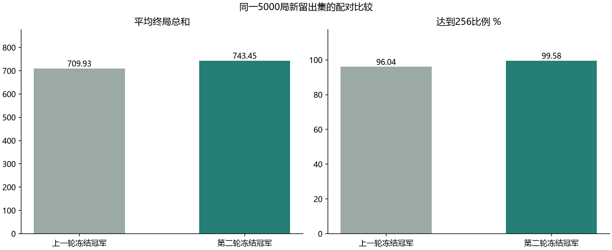
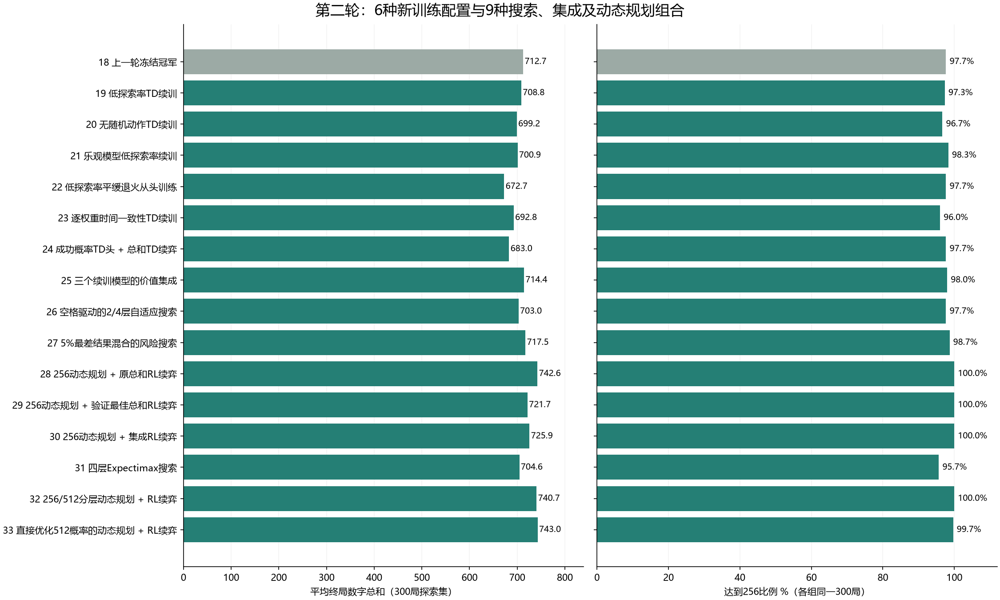

# 3×3 2048 第二轮探索报告

本轮新增 **15个训练、搜索与组合配置**（19–33），加上上一轮冻结冠军对照，共16组。累计前后两轮32个配置，包含同家族消融，不能称为32种互相独立的强化学习算法。额外完成130万局学习训练，两轮累计320万局；动态规划枚举状态另计。

最终选定 **32_hierarchical_dp**。在完全新留出集的 **5000局** 中，达到256 **4979局（99.58%）**，平均终局总和 **743.45**，达到512 **72.48%**。与上一轮冠军在相同落块随机数下比较，平均总和增加 **33.52**，配对bootstrap的95%区间 **[27.13, 39.80]**。



## 新留出集结果与选择程序

| 指标 | 上一轮冻结冠军 | 第二轮冻结冠军 |
|---|---:|---:|
| ≥256 | 96.04% | 99.58% |
| 平均终局总和 | 709.93 | 743.45 |
| ≥512 | 64.92% | 72.48% |
| 样本最大块 | 512 | 1024 |
| 样本最高总和 | 1020 | 1400 |
| 毫秒/步 | 0.0896 | 0.0180 |

新冠军≥256的95% Wilson区间为 **[99.36%, 99.73%]**；总和均值的95% bootstrap区间 **[738.62, 748.12]**。仍有 **21局** 未达256，随机落块下不提供每局必达保证。按相同种子配对，新模型救回旧模型未达标的 197 局，也有 20 局旧模型达标而新模型未达标；达标率净增 3.54 个百分点。

最终选择在留出集评测之前冻结，规则为：优先保留256数值动态规划策略的候选（28、29、30、32），再按新验证集平均总和取最大值。直接优化512的33不满足这条256优先规则，因此不会因探索总和较好而替换冠军。这是对“最大块不小于256”的概率优先处理，并非精确求解原始硬约束总和问题。

- 验证集：61000–61299，每组300局；用于模型与组合选择。
- 探索集：71000–71299，每组300局；已反复查看，仅作研究比较。
- 最终留出集：80000–84999，只比较冻结的新旧冠军，不在这个集合调参或选模型。
- 原Gym环境另验90000–90299，共300局：≥256 **99.67%**，平均总和 **743.25**。使用不同随机发生器，不能将同号种子与快速引擎逐步等同。
- 最终留出集截断 0 局；代理只接收当前棋盘，没有读取实际未来落块，达到256/512后仍继续至无合法动作。

## 16组实际比较



| 编号 | 方法 | 验证均值 | 探索均值 | 探索≥256 | 探索≥512 | 毫秒/步 |
|---|---|---:|---:|---:|---:|---:|
| 18 | 上一轮冻结冠军 | 734.87 | 712.69 | 97.67% | 65.00% | 0.0923 |
| 19 | 低探索率TD续训 | 710.87 | 708.79 | 97.33% | 64.33% | 0.0923 |
| 20 | 无随机动作TD续训 | 709.60 | 699.23 | 96.67% | 63.00% | 0.0933 |
| 21 | 乐观模型低探索率续训 | 689.60 | 700.88 | 98.33% | 64.33% | 0.0917 |
| 22 | 低探索率平缓退火从头训练 | 669.31 | 672.71 | 97.67% | 61.00% | 0.0952 |
| 23 | 逐权重时间一致性TD续训 | 685.69 | 692.75 | 96.00% | 66.00% | 0.0934 |
| 24 | 成功概率TD头 + 总和TD续弈 | 692.63 | 683.01 | 97.67% | 60.33% | 0.0956 |
| 25 | 三个续训模型的价值集成 | 709.57 | 714.42 | 98.00% | 65.33% | 0.0940 |
| 26 | 空格驱动的2/4层自适应搜索 | 713.98 | 702.97 | 97.67% | 66.00% | 0.6646 |
| 27 | 5%最差结果混合的风险搜索 | 733.25 | 717.49 | 98.67% | 67.67% | 0.0907 |
| 28 | 256动态规划 + 原总和RL续弈 | 735.07 | 742.62 | 100.00% | 70.00% | 0.0365 |
| 29 | 256动态规划 + 验证最佳总和RL续弈 | 730.30 | 721.72 | 100.00% | 67.00% | 0.0360 |
| 30 | 256动态规划 + 集成RL续弈 | 724.69 | 725.94 | 100.00% | 66.67% | 0.0365 |
| 31 | 四层Expectimax搜索 | 724.08 | 704.64 | 95.67% | 63.33% | 1.7146 |
| 32 | 256/512分层动态规划 + RL续弈 | 754.05 | 740.74 | 100.00% | 73.33% | 0.0174 |
| 33 | 直接优化512概率的动态规划 + RL续弈 | 743.26 | 743.01 | 99.67% | 74.67% | 0.0177 |


每组均值取所有对局，包括失败局。训练种子、训练预算和搜索成本不同，因此此表是有限预算配置比较，不能单独归因于某一算法技巧。耗时不含首次编译，包含批量模拟器成本；本机部分任务同时运行，耗时只作近似参考。

## 各配置的探索内容

**18_previous：上一轮冻结冠军**。上一轮冻结的分阶段双TD模型与三层Expectimax，作为同种子对照，未重新训练。 验证均值734.87，探索均值712.69，探索≥256 97.67%。

**19_low_epsilon：低探索率TD续训**。总和TD的30万局模型额外训练20万局；探索率0.0005、学习率0.01，检验降低训练期随机动作能否改善。 验证均值710.87，探索均值708.79，探索≥256 97.33%。

**20_greedy_refine：无随机动作TD续训**。同一个总和模型额外训练20万局；不随机选动作，落块仍随机。用于分离环境随机性和动作探索的效果。 验证均值709.60，探索均值699.23，探索≥256 96.67%。

**21_optimistic_refine：乐观模型低探索率续训**。从上一轮30万局乐观TD继续20万局，探索率0.0005，学习率0.01。 验证均值689.60，探索均值700.88，探索≥256 98.33%。

**22_anneal：低探索率平缓退火从头训练**。从头训练30万局，价值初值300；学习率0.03→0.01、探索率0.002→0.0002。与续训组的起点和总预算不同。 验证均值669.31，探索均值672.71，探索≥256 97.67%。

**23_coherence：逐权重时间一致性TD续训**。从总和TD继续20万局。每个权重按累计有符号误差绝对值/累计绝对误差缩放学习率，基础学习率0.2。首个更新系数1，重复对称特征归一。实现基础TC思想，未复现论文的延迟更新等整套系统。 验证均值685.69，探索均值692.75，探索≥256 96.00%。

**24_success_head：成功概率TD头 + 总和TD续弈**。训练20万局独立成功概率TD头，成功终点值1、失败0，不加总和奖励；使用总和TD教师引导80%→20%的动作。达到256后改用总和TD。概率估计在搜索叶子截断到[0,1]。 验证均值692.63，探索均值683.01，探索≥256 97.67%。

**25_ensemble：三个续训模型的价值集成**。将19、20、21的同结构权重逐项平均；由于N-tuple价值是线性的，等价于三个价值估计求均值。未额外训练。 验证均值709.57，探索均值714.42，探索≥256 98.00%。

**26_adaptive：空格驱动的2/4层自适应搜索**。复用验证集选出的总和模型；256前空格至少4个用两层，否则四层；256后用三层。检验把搜索预算放在拥挤局面。 验证均值713.98，探索均值702.97，探索≥256 97.67%。

**27_risk：5%最差结果混合的风险搜索**。在每个机会节点混合95%落块期望与5%最差落块值；256后恢复普通期望搜索。风险系数固定0.05，未在留出集调参。 验证均值733.25，探索均值717.49，探索≥256 98.67%。

**28_tablebase_rl：256动态规划 + 原总和RL续弈**。256前查询动态规划动作表，成功概率并列时用带RL边界的未来总和估计打破平局；256后用原总和TD三层搜索。 验证均值735.07，探索均值742.62，探索≥256 100.00%。

**29_tablebase_refined：256动态规划 + 验证最佳总和RL续弈**。256前与28完全相同；256后换成新验证集选出的总和RL模型。改变续弈模型不改变之前的256成功概率。 验证均值730.30，探索均值721.72，探索≥256 100.00%。

**30_tablebase_ensemble：256动态规划 + 集成RL续弈**。256前同28，256后用25的集成价值搜索。 验证均值724.69，探索均值725.94，探索≥256 100.00%。

**31_depth4：四层Expectimax搜索**。复用新验证集选出的总和模型，整局固定四层Expectimax。深度按玩家走子次数计，层间枚举所有空位与2/4概率。 验证均值724.08，探索均值704.64，探索≥256 95.67%。

**32_hierarchical_dp：256/512分层动态规划 + RL续弈**。256前用256概率动作表；256至512之间用512概率动作表；512后由20的总和TD三层续弈。保留256优先目标。 验证均值754.05，探索均值740.74，探索≥256 100.00%。

**33_direct512_dp：直接优化512概率的动态规划 + RL续弈**。整段512前都使用512概率动作表，达到512后RL续弈。可能牺牲256概率，用于展示两个目标并不完全相同。 验证均值743.26，探索均值743.01，探索≥256 99.67%。

## 为什么加入动态规划

3×3的状态空间比4×4小。有效滑动合并不改变总和，随后随机新增2或4使总和严格增加，所以玩家状态转移图无环。可以按递归记忆化求解：

`P(s) = max_a E_spawn[P(next(s,a))]`，达到目标为1，终局未达到为0。

我们按真实规则枚举所有空位和2/4概率，而不是仅取最可能落块。目标256之前，每格指数0–7，直接索引空间8^9；目标512之前每格指数0–8，空间9^9。只缓存初始分布可达的状态；部署只保留动作表，不携带求解时的概率缓存。动态规划本身属于已知模型下的规划，本轮交付是它与实际训练的强化学习价值网络结合，不能将枚举状态数算作强化学习训练局数。

| 计算 | 目标256 | 目标512 |
|---|---:|---:|
| 实际访问状态数 | 48,680,615 | 114,088,687 |
| 直接索引槽位 | 134,217,728 | 387,420,489 |
| 初始分布计算成功概率 | 99.5709643199% | 73.6774177023% |
| 求解秒数 | 63.0 | 138.8 |

初始分布严格包含两次无放回空位选择、每次90%为2/10%为4。递归以float64计算概率，以1e-12作为概率平局容差，以float32缓存次级总和估计。这是数值动态规划结果，未做有理数/区间算术证明，因而不能声称形式化最优性证书。512计算值对应直接512策略，不是分层32的512成功率。

概率平局时，估计未来新增总和并选较大者；到达目标后的边界价值来自已训练的RL网络。所以主目标概率有完整模型枚举，次目标总和依然有函数近似误差，而且运行时使用三层搜索，与计算边界的一层价值并不完全相同。没有宣称总和全局最优。28–30改变运行期续弈网络，共用同一份256前动作表；32再增加512阶段。

最终模型压缩文件约 **55.7 MiB**，加载的数组约 **521.5 MiB**（另有Python/编译器成本）。256求解缓存约1.63GiB，512约4.69GiB，不含模型与运行时；时间和空间换来了较低的在线决策成本。完整动作表无法用一个12MiB的TD网络替代而保证相同动作。

## 强化学习新增预算与复现细节

19、20、21各续训20万局；22从头30万局；23续训20万局；24概率头20万局。合计130万局。继承网络还用到了上一轮训练预算，不能说最终方案只用本轮预算训练。每批2万局，训练种子分别20261105、20261105、123、456、789、1234，批次种子=基础种子+已训练局数；具体曲线见training目录。

网络仍为3张16^5的5-tuple表，D4共享24个特征，约12MiB/头。19–23学习的是无折扣未来新增总和；24学习未来成功概率。评测不更新权重、不探索。重复对称特征更新归一；TD学习率与TC基础学习率尺度不同。24的训练记录到首次256就结束，故其训练期总和值不能与完整对局训练曲线直接比较；其评测仍继续到终局。

本轮发现更多训练不一定更好：续训、探索率改变、TC、概率头与集成都如实保留完整结果，没有因为弱于基线而删除。各配置仅使用一个新训练种子，不代表训练分布的稳定结论。新留出区间只度量固定模型的对局随机性，不包含训练、验证选择和规则实现的不确定性。

风险搜索在实验进程运行中修正过“把所有负叶子值截成0”的问题，最终27的300局验证和300局探索结果已经在修正后单独重跑。零风险与原期望搜索相等的单元测试覆盖了负叶子值。初始manifest保留启动时源码哈希，delivery_audit.json另记录交付版本哈希；两者不同是已披露的修订，未把启动哈希冒充最终哈希。

## 资料来源与采用范围

- [Simon Tatham：Analysing 2048 on a 3×3 board](https://www.chiark.greenend.org.uk/~sgtatham/quasiblog/small2048/)（2026-09-09）：3×3可枚举状态、总和单调、不同目标策略的分析，促成本轮DP路线。我们独立实现Python/Numba求解，没有导入该文动作表。数值结果与其约99.6%/73.7%的参照一致，不以他人成绩代替本地实测。
- [Guei等：Optimistic Temporal Difference Learning for 2048](https://arxiv.org/abs/2111.11090)：乐观初始化与利用落块随机性探索。19–22检验低动作探索与初始化的组合；没有复现论文全部系统。
- [Jaśkowski：Mastering 2048…](https://arxiv.org/abs/1604.05085) 及[作者TDL2048实现](https://github.com/moporgic/TDL2048)：TC与N-tuple价值学习。23采用逐权重误差一致性缩放，未实现延迟更新、轮盘塑形或全部多阶段技巧。

## 已交付内容与运行

双击项目根目录play.bat观看最新模型；空格暂停，R新局，Esc退出。旧模型、第一轮报告与原始数据均保留。示例回放固定取原Gym验证的第一局（种子90000），没有挑选成功局替代整体统计。

```powershell
.\.venv\Scripts\python.exe -m game2048.autoplay
.\.venv\Scripts\python.exe -m game2048.autoplay --headless --games 100 --seed 100000
# 显式使用第一轮模型
.\.venv\Scripts\python.exe -m game2048.autoplay --artifacts artifacts/final --headless --games 100
# 完整复现第二轮；已完成训练与表可复用
.\run_round2.ps1
.\.venv\Scripts\python.exe -m pytest -q
```

final/best.json记录冻结选择，final/champion_holdout.csv和previous_holdout.csv记录配对原始数据，final/holdout_summary.json包含区间与差值。validation、raw保存全部16组逐局结果，tablebase及tablebase512保存求解统计与动作表。summary.csv是便于查看的总表。源码中的硬编码种子区间是本轮复现设置，新增研究应另建区间，避免再次把已查看数据当作新留出集。

交付检查见delivery_audit.json。图表和原游戏最终画面经图片检查；离线HTML回放以无浏览器脚本检查交互。此前浏览器安全策略阻止本地HTML直接打开，未绕过限制，也未声称浏览器实点验证。
