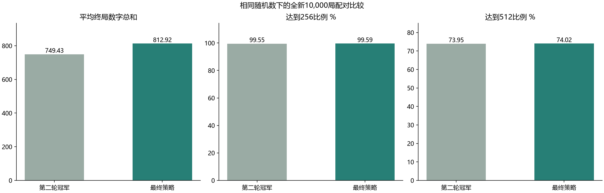
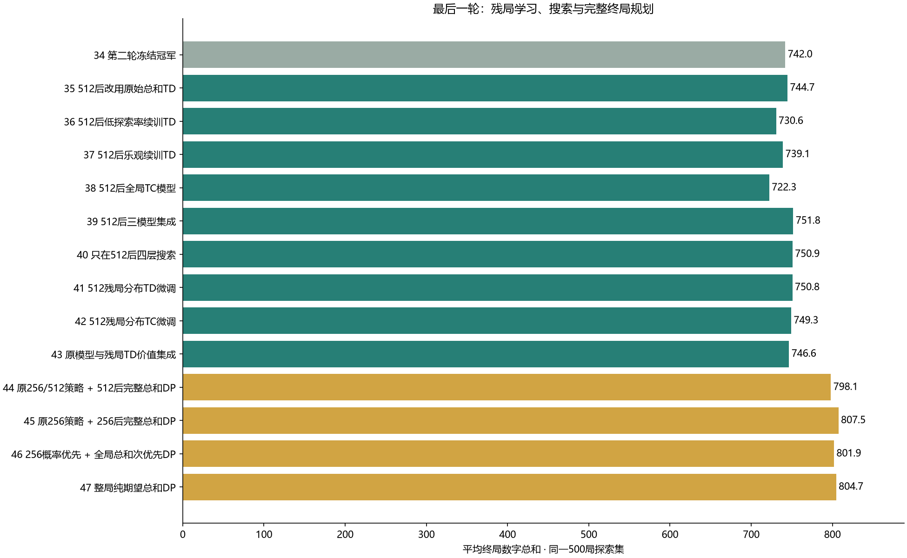

# 3×3 2048 最后一轮探索报告

**还有探索价值，但收益来自完整规划，而不是继续堆训练。** 本轮完成13个新配置（35–47），加上第二轮冠军对照共14组；新增30万局残局学习训练，另用3000局独立生成残局起始分布。三轮合计45个配置、350万局学习训练；同一家族的变体不算独立算法。

最终策略为 **46_lexicographic：256达标概率优先，再最大化期望终局数字总和**。它完整枚举终局，没有RL边界估计。它属于已知模型规划，**不是新的强化学习算法**；本轮RL方案与上一轮RL组合全部保留，可继续运行和比较。

## 新10,000局结果

模型在留出集之前冻结。新旧策略使用同一批预先生成的落块随机数，所有对局都计入，包括失败局。

| 指标 | 第二轮冻结冠军 | 最终策略 |
|---|---:|---:|
| 平均终局总和 | 749.43 | **812.92** |
| ≥256 | 99.55% | **99.59%** |
| ≥512 | 73.95% | **74.02%** |
| 1024块出现局数 | 1 | 109 |
| 样本最高终局总和 | 1276 | 1786 |
| 毫秒/步 | 0.0175 | 0.0007 |
| 步数上限截断 | 0 | 0 |



平均总和净增 **63.48**，配对bootstrap 95%区间 **[59.56, 67.35]**。新模型总和均值95%区间 **[808.81, 816.95]**；≥256的95% Wilson区间 **[99.44%, 99.70%]**。

仍有 **41局** 未达256，不能保证每局成功。相同种子下救回旧策略未达标的34局，也有30局旧策略达标、新策略未达标。两者256前选择不同，且理论计算成功率接近相同；小幅样本率变化不应解释为突破概率上限。

原始Gym环境另测种子3000000–3000499的500局：≥256 **100.00%**，平均总和 **815.84**。快速引擎与Gym的随机发生器不同，不把同号种子轨迹当作应当相同。

## 本轮究竟探索了什么



| 编号 | 配置 | 验证总和 | 探索总和 | 探索≥256 | 探索≥512 | 毫秒/步 |
|---|---|---:|---:|---:|---:|---:|
| 34 | 第二轮冻结冠军 | 730.94 | 741.98 | 99.40% | 71.80% | 0.0176 |
| 35 | 512后改用原始总和TD | 743.23 | 744.71 | 99.40% | 71.80% | 0.0169 |
| 36 | 512后低探索率续训TD | 737.22 | 730.65 | 99.40% | 71.80% | 0.0170 |
| 37 | 512后乐观续训TD | 730.55 | 739.06 | 99.40% | 71.80% | 0.0166 |
| 38 | 512后全局TC模型 | 717.78 | 722.27 | 99.40% | 71.80% | 0.0160 |
| 39 | 512后三模型集成 | 744.84 | 751.77 | 99.40% | 71.80% | 0.0180 |
| 40 | 只在512后四层搜索 | 738.26 | 750.86 | 99.40% | 71.80% | 0.2132 |
| 41 | 512残局分布TD微调 | 750.20 | 750.77 | 99.40% | 71.80% | 0.0184 |
| 42 | 512残局分布TC微调 | 741.88 | 749.30 | 99.40% | 71.80% | 0.0180 |
| 43 | 原模型与残局TD价值集成 | 746.16 | 746.58 | 99.40% | 71.80% | 0.0181 |
| 44 | 原256/512策略 + 512后完整总和DP | 796.74 | 798.09 | 99.40% | 71.80% | 0.0005 |
| 45 | 原256策略 + 256后完整总和DP | 789.42 | 807.51 | 99.40% | 73.60% | 0.0005 |
| 46 | 256概率优先 + 全局总和次优先DP | 793.23 | 801.95 | 99.20% | 72.20% | 0.0007 |
| 47 | 整局纯期望总和DP | 785.32 | 804.67 | 99.40% | 73.80% | 0.0007 |


**34：第二轮冻结冠军**。第二轮已冻结的256→512概率规划与RL续弈，原样封装后逐局核对三个独立种子的全部结果。

**35：512后改用原始总和TD**。前两阶段相同，512后改用第一轮30万局纯总和TD模型。

**36：512后低探索率续训TD**。512后改用第二轮低探索率续训模型19。

**37：512后乐观续训TD**。512后改用第二轮乐观续训模型21，检验初始化偏好是否适合残局。

**38：512后全局TC模型**。512后改用第二轮全局TC续训模型23。

**39：512后三模型集成**。512后改用第二轮19、20、21三个网络的价值平均。

**40：只在512后四层搜索**。只把512之后的Expectimax从三层加至四层，前两个阶段保持相同。

**41：512残局分布TD微调**。从旧策略独立生成的首次512玩家状态出发续训20万局，纯总和TD，学习率0.005、探索率0.0005。

**42：512残局分布TC微调**。同样的残局起始分布，TC训练10万局，基础学习率0.05、探索率0.0005。比较预算不同，不单独归因于TC。

**43：原模型与残局TD价值集成**。原模型20与残局TD模型41逐权重平均，缓解只在残局分布微调带来的偏移。

**44：原256/512策略 + 512后完整总和DP**。保留旧的256/512两个阶段，512后切换完整期望总和规划，不再使用学习叶子。

**45：原256策略 + 256后完整总和DP**。保留旧的256阶段，达到256就切换完整期望总和规划，避免512阶段只顾目标概率。

**46：256概率优先 + 全局总和次优先DP**。重新求解256前的概率/总和双目标；先最大化达到256概率，概率相同再最大化完整终局总和。256后纯总和规划。

**47：整局纯期望总和DP**。从开局起直接最大化期望终局总和，用于观察放松256优先约束的理论代价。

35–43只改512之后的续弈，因此在同一落块序列下达到256/512的比例完全相同，主要检验总和；更换续弈网络也改变以后落块落在哪些空位，并非相同坐标的强行回放。41/42把训练预算集中在残局，确有局部改进，但本轮有限预算仍落后于完整规划。

44说明仅修好512之后已能明显改善；45说明把256后的目标直接改成总和，也有帮助。46再修正了256前的概率平局选择。47显示纯总和与256优先的数值最优期望相差极小，但这是计算结果，不能因500局样本的均值排序不同就改变冻结规则。

## 完整终局规划如何计算

令M(s)表示从当前玩家状态起还会新增的数字总和，终局为0。每个合法动作a先滑动合并，再按规则均匀选择空位、以90%/10%新增2/4：

`M(s) = max_a E[新增数字 + M(next_state)]`。

到256后不终止，到512/1024后也不终止，直到所有方向都无效。合并本身不增加总和，所以上式加初始棋盘总和就是期望终局总和。与前两轮不同，本轮没有学习网络作为叶子近似，没有有限搜索深度，也没有截断1024残局。

全局总和表求出后，再对256前求双目标(P,M)：先比较达到256概率P，概率并列时比较完整未来总和M；到256后直接接上全局总和表。这里总和是第二个优化目标，不是给成功任意加一个奖励权重。

| 完整计算结果 | 数值 |
|---|---:|
| 纯总和策略的初始期望终局总和 | 811.235465226 |
| 256概率优先策略的初始期望终局总和 | 811.231549278 |
| 后者初始达到256概率 | 99.5709643199% |
| 完整总和实际访问状态 | 388,921,077 |
| 256前双目标实际访问状态 | 48,680,615 |
| 求解时间 | 332.6秒 |

标准3×3规则从两个2/4开始无法产生2048，因此格子只需0与2–1024的11种取值，直接索引11^9=2,357,947,691个槽。有效走子后随机新增数字使总和严格增加，没有循环，可以记忆化递归。这一边界来自[Simon Tatham的3×3分析及不可能性论证](https://www.chiark.greenend.org.uk/~sgtatham/quasiblog/small2048/)；我们自行实现并在遇到意外2048时显式报错，没有导入第三方动作表。

概率与总和缓存均为float64；概率平局容差1e-12，总和平局容差1e-10。计算出的256概率与上一轮相差不足2e-9。这里是完整时域的**数值解**，没有有理数或区间算术证书，不能称为形式化最优性证明。也不意味着有限样本均值必然等于计算期望。

## 内存压缩与运行成本

求解时使用约22 GiB的直接索引缓存，另有运行时和压缩临时数组；本机可用内存足够，求解后释放价值缓存。部署只保留可达非终局状态的动作。

对每个棋盘计算8种旋转/镜像，取最小索引作为规范表示，只保存这个代表；查询时把动作正确变换回原棋盘。键以uint32排序保存（完整索引可能超过有符号32位范围），动作用uint8，二分查找；终局无需存储，无解但仍可移动的未知棋盘会报错。

- 总和表规范状态：41,325,017个，数组197.1 MiB。
- 256前双目标表规范状态：5,643,584个，数组26.9 MiB。
- 最终加载的两张动作表合计 **224.0 MiB**，对比上一轮约521.5 MiB，减少约 **57.1%**。这是数组内存，Python/Numba另占空间。
- 两张压缩表磁盘合计约 **69.3 MiB**；磁盘文件比上一轮55.7 MiB稍大，内存更小。在线耗时不含首次加载与编译，包含模拟器成本；本机并发任务会影响计时。

## 实验协议与诚实边界

- 残局起始数据：旧规划策略在1100000–1102999共3000局中首次达到512的玩家状态；未用验证或留出局面训练。
- 新训练：41额外20万局、42额外10万局，种子20261106。TC累计误差在一次完整训练调用内保留，未逐局重置。初始模型都是第二轮20。43无额外训练。
- 验证集1200000–1200499、探索集1300000–1300499，各500局，全部14组；评测不更新模型。
- 新留出集2000000–2009999共10000局，只比较冻结的旧冠军与46。
- 46在运行留出集之前冻结，依据预先写入manifest的双目标Bellman准则及规则、对称映射、完整覆盖检查，**不是按500局验证均值最大选择**。验证集用来检查实现；事实上44的验证均值高于46，这没有改变冻结选择。数值解的目标与用户的256优先、总和次目标一致。
- 先屏蔽无效方向，再按真实概率落块；策略不读取未来随机数，不改写落块，不重试失败局，不在达到256时停止。
- 区间只描述固定策略的对局随机性；均值bootstrap2000次，差值配对bootstrap4000次。没有把13个配置称为13个独立RL算法，也没有把数亿规划状态算作学习训练局数。

测试包含原Gym规则与小规模完整总和Bellman的独立比较、8种对称的方向映射、压缩前后策略一致性、残局训练可复现、模型相对路径加载。交付记录另核对全部逐局结果与留出摘要、原模型哈希和完整回放。早期评测器在产生首条实验记录前修正过Numba行写入编译错误；初始manifest保留，最终源码哈希另存delivery_audit.json。

## 结论：是否还值得继续训练

本轮值得做：之前把达到512当作概率目标、之后依赖近似续弈，留下了明显总和空间。新增残局训练说明改变采样分布有帮助，但完整规则规划更适合这个小状态空间问题。

**本轮之后，固定3×3、标准落块、同一双目标下，再堆大量训练的价值很低。** 我们已经给出了覆盖可达终局状态的数值Bellman解及实测校验，模型误差不再是主要瓶颈。还可研究更小部署、形式化数值误差验证，或推广到4×4/不同规则；这些是不同的工程或研究目标，不能承诺继续明显提高当前目标。随机导致的失败也不会靠无限训练消失。

本轮最强交付是纯规划，强化学习版本没有删除。若项目评分要求代理主体必须为强化学习，请使用上一轮组合或本轮41/43，并把46作为完整规划对照，而不要把46冒称为RL。

## 运行与文件

```powershell
# 默认最新自主游戏；空格暂停，R新局，Esc退出
.\.venv\Scripts\python.exe -m game2048.autoplay
# 保留的强化学习+规划混合版本
.\.venv\Scripts\python.exe -m game2048.autoplay --artifacts artifacts/round2/final
# 本轮残局TD混合版本
.\.venv\Scripts\python.exe -m game2048.autoplay --model artifacts/round3/models/41_tail_td.npz
# 独立无窗口对局
.\.venv\Scripts\python.exe -m game2048.autoplay --headless --games 100 --seed 4000000
# 完整复现；复用已完成的表和训练
.\run_round3.ps1
```

最终入口final/best.json与final/champion.npz引用相邻tables目录中的mass.npz、lex.npz。**复制模型时须同时保留这两张表及相对目录结构，单独的champion.npz不足以运行。** 旧RL组合还需要tables/previous.npz，已保留。模型加载以文件自身位置解析路径，不依赖当前工作目录。

summary.csv保存14组汇总，validation/raw为逐局数据，training为残局样本与训练统计，tables/solve.json为完整计算记录，final保存10000局配对原始结果、Gym500局与固定第一局回放。play.bat默认最新模型，原第一、二轮报告与权重均保留。
