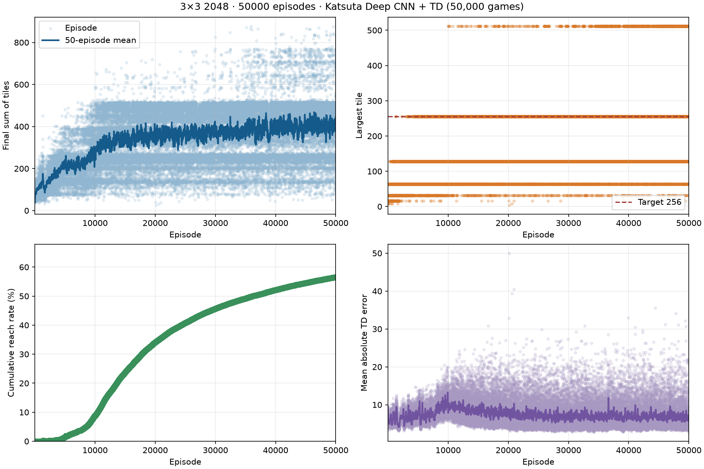
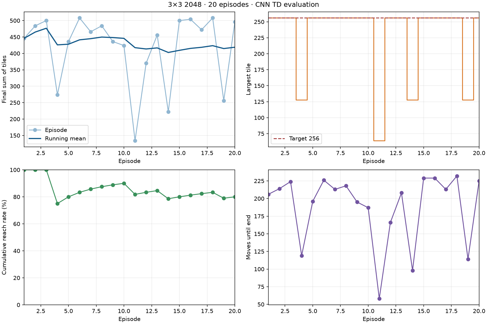

# CNN TD-Afterstate

TD 默认使用参考 Katsuta（胜田塔子，2024）Deep 结构的 CNN 后继状态价值网络。旧 n-tuple 版本保存在 `ntuple.py`，已有 `models/td-3x3.pkl` 仍可读取。

## 文献与复现范围

[Katsuta 的公开学士论文摘要](https://www.kochi-tech.ac.jp/library/ron/pdf/2023/03/13/a1240305.pdf)明确使用 **3×3 Mini2048**，Deep 网络在训练 8 小时后平均游戏得分为 **4564.2**。摘要图 1(a) 给出网络尺寸，正文说明采用 [Matsuzaki（2021）的学习方法](https://www.jstage.jst.go.jp/article/ipsjjip/29/0/29_336/_pdf)。后者使用移动合并后、随机生成前的棋盘作为输入，预测未来合并奖励，并用批量 TD 标签和 Adam/MSE 训练。

摘要没有另行定义计分方式；这里依据它引用的 Matsuzaki 方法，按累计合并分解读论文的游戏得分。它与本项目的终局棋盘总和是两项指标。统一评测现在同时输出 `mean_sum` 和 `mean_merge_score`，不把 4564.2 当作棋盘总和。

[学校目录](https://www.kochi-tech.ac.jp/library/ron/2023/13/202313.html)将 Katsuta 全文标记为校内限定。公开摘要没有给出完整的优化器、随机种子、训练局数或评测样本信息。本实现复用可确认的结构与 TD-afterstate 方法，并明确记录下面的适配；提供的短时 CPU 训练结果不等同于复现论文 8 小时成绩。

## 网络

每个后继棋盘编码为 `11×3×3`，通道依次表示空格、2、4、…、1024，每格恰好有一个通道为 1。非法值会报错，不截断大块指数。

| 层 | 卷积核 / 通道 | 输出尺寸 |
| --- | --- | --- |
| 输入层 | 1×1，11 → 21，ReLU | 21×3×3 |
| 空间卷积 1 | 2×2，21 → 43，padding=1，ReLU | 43×4×4 |
| 空间卷积 2 | 2×2，43 → 77，ReLU | 77×3×3 |
| 空间卷积 3 | 2×2，77 → 85，ReLU | 85×2×2 |
| 空间卷积 4 | 2×2，85 → 85，ReLU | 85×1×1 |
| 全连接 | 85 → 85，ReLU | 85 |
| 标量价值头 | 85 → 1，线性 | 1 |

参数共 **79,874** 个。论文所说的四层卷积不计公共的 1×1 输入层，因此代码实际包含五个 `Conv2d`。

标量头使用线性输出，替代摘要图中的末层 ReLU：试训中，末层 ReLU 在归一化 TD 目标下会陷入恒零输出并失去梯度。其余层尺寸来自摘要。初始化、目标归一化、梯度裁剪、探索设置和同步批量生成器也属于本项目适配，并非摘要提供的完整实验配置。

## 两种训练目标

后继状态 `z_t` 指本次移动/合并后、随机生成方块前的棋盘。

### 项目总和目标（默认）

保留项目原目标：`U = 终局总和 + target_bonus × 是否达到 256`，默认 `target_bonus=256`。达到 256 后继续到无合法移动。

令已知基线 `B(z) = sum(z) + target_bonus × I(max(z) ≥ 256)`，网络学习其上的剩余效用：

```text
V(z) = B(z) + value_scale × CNN(z)

相邻后继状态的 TD 标签：Y_t = V(z_{t+1})
自然终局的 TD 标签：    Y_t = 实际终局总和 + target_bonus × 是否达标
归一化回归标签：        (Y_t - B(z_t)) / value_scale
```

默认 `value_scale=1024`。行动选择最大化 `V(move(s,a))`，不加合并奖励。随机生成的 2/4 已通过下一棋盘总和进入标签，不重复累加。已获得的达标奖励进入已知基线，不在每次移动中重复奖励。这是对原终局效用 TD 的重新参数化，没有改变不折扣的目标。

### 论文合并分目标

`--td-objective merge` 时，基线为 0，网络预测该后继状态之后的未来合并分；要求 `target_bonus=0`：

```text
行动选择：a = argmax_a [merge_reward(s,a) + V(move(s,a))]
TD 标签： Y_t = merge_reward(s_{t+1},a_{t+1}) + V(z_{t+1})
终局标签：Y_t = 0
```

本次行动的合并奖励只用于当前行动选择，不重复计入当前后继状态的未来价值。用 `--td-value-scale 1` 可直接回归未归一化合并分；用 `--epsilon-start 0 --epsilon-end 0` 可采用贪心自我对弈。这两个选项更接近所引用 2021 方法的训练设置，仍不能据此声称完整复现 2024 全文。

## 批量训练与模型

`training.py` 同步运行多个独立游戏，把它们的全部合法后继状态放入同一次 CNN 推理。TD 标签取推理时的数值并停止梯度，进入 FIFO 队列；累计到批量大小后，用 Adam 和均方误差更新一次，每条标签只消费一次，没有经验回放、教师或最优状态表。最后不足一批的标签也会训练。

默认 32 个并行棋局、每批 1024 个标签、Adam 学习率 0.001、`eps=1e-7`、梯度范数上限 10，不使用折扣。探索 ε 在前 5000 局从 0.10 线性降到 0.01。`--max-steps` 的截断用后继价值自举，不能作为自然终局的零价值训练。

CNN 模型使用 `.pt`，保存网络、Adam 动量、配置、已完成局数、训练位置数、优化步数和动作 RNG 状态；写入后原子替换。默认每 500 局保存一次检查点，训练结束再保存。续训恢复优化器，`--learning-rate` 会实际修改已加载优化器的学习率；可调整批量和 ε 参数。更换目标、达标奖励或价值缩放需要重新训练，续训入口会拒绝这些更改。中途检查点不保存尚在运行的棋局或 FIFO 队列；续训开始新的棋局，需指定后续训练种子。

## 命令

```bash
uv sync --extra td

# 从零训练：仅使用 CNN 自身棋局，种子避开验证集 8000–8099 和测试集 10000–10099
uv run --extra td game2048-play --algorithm td --mode train --episodes 10000 --seed 20000 --n-envs 32 --model models/my-td-cnn.pt

# 续训，可降低学习率；不重复前一批训练种子
uv run --extra td game2048-play --algorithm td --mode train --resume --episodes 40000 --seed 30000 --learning-rate 0.0003 --model models/my-td-cnn.pt

# 评测与展示默认 CNN 检查点
uv run --extra td game2048-play --algorithm td --mode eval --episodes 100 --seed 10000
uv run --extra td game2048-play --algorithm td --mode watch --seed 5001

# 论文合并分目标，单独从零训练
uv run --extra td game2048-play --algorithm td --mode train --td-objective merge --td-value-scale 1 --epsilon-start 0 --epsilon-end 0 --episodes 10000 --seed 20000 --model models/my-td-cnn-merge.pt

# 旧 n-tuple 模型仍可单独评估或续训
uv run game2048-play --algorithm td --td-network ntuple --mode eval --episodes 20 --seed 10000
uv run game2048-play --algorithm td --td-network ntuple --mode train --resume --alpha 0.02 --episodes 1000 --seed 12000 --model models/my-ntuple.pkl
```

CNN 默认模型为 `models/td-3x3-cnn.pt`；显式提供 `.pkl` 路径时自动选择旧 n-tuple，或用 `--td-network ntuple` 指定。PPO 的旧 TD 教师继续使用原来的 `.pkl`，已有 PPO 模型和教师记录保持可复现。

日志逐局记录总和、合并分、最大块和结束原因，`td_update` 记录真正的批量 MSE 与平均绝对 TD 误差。逐局 `td_loss` 是最近一次已完成批量更新的 MSE，第一次更新前为 `null`。训练曲线显示逐局总和、50 局平均、最大块、达标率及 TD 误差；绝对 TD 误差和游戏分数不能混为一谈。

单元测试验证通道编码、参数量、两种目标的奖励时序、CNN 梯度更新、优化器恢复、续训学习率、截断自举、旧模型加载及 CLI 输出。完整游戏评测另用未参与训练的固定种子完成。

## 提供的检查点与实测

`models/td-3x3-cnn.pt` 使用项目总和目标，`target_bonus=256`、`value_scale=1024`，没有教师或搜索辅助。模型完成 50,000 局、7,512,917 个训练位置、7,337 次优化更新，检查点约 956 KiB。

| 阶段 | 训练种子范围 | 纳入的已完成局数 | 学习率 |
| --- | --- | ---: | ---: |
| 从零训练 | 20000–29999 | 10,000 | 0.001 |
| 续训至保存的 49,000 局检查点 | 30000–69030，含当时未结束的并行棋局 | 39,000 | 0.0003 |
| 环境中断后的补齐训练 | 70000–70999 | 1000 | 0.0003 |

训练曲线只纳入最终检查点对应的 50,000 局，未把中断后未保存的训练算进来。上述阶段的有效 CPU 运行时间合计约 14.8 分钟，不含试训与评估。最后 500 个训练棋局平均总和 406.59；训练阶段有 ε 探索，和贪心测试分开报告。[训练记录](../../../docs/td-cnn-training.json)保存阶段信息、模型哈希及每 500 局统计。

| 独立评测 | 局数 | 平均总和 | 平均合并分 | 达到 256 | 达到 512 |
| --- | ---: | ---: | ---: | ---: | ---: |
| 验证种子 8000–8099 | 100 | 470.96 | 2857.20 | 93/100 | 14/100 |
| 测试种子 10000–10019 | 20 | 418.80 | 2418.20 | 16/20 | 0/20 |
| 测试种子 10000–10099 | 100 | 443.74 | 2652.80 | 83/100 | 10/100 |

20 局是 100 局测试集的子集。测试集最高总和为 816，最高合并分为 5812，全部自然结束；平均成绩尚未达到论文的 4564.2。一次本机 100 局 CLI 评测含模型加载与绘图约 9.7 秒。

旧 5000 局 n-tuple 模型在相同 100 个测试种子上重跑：总和 385.50、合并分 2181.52、72/100 达到 256。CNN 检查点总和高 58.24，但使用了十倍训练局数，不能把全部提升归因于 CNN 架构。完整逐局数据、验证集、旧模型对照及模型哈希在 [评测记录](../../../docs/td-cnn-evaluation.json)。




