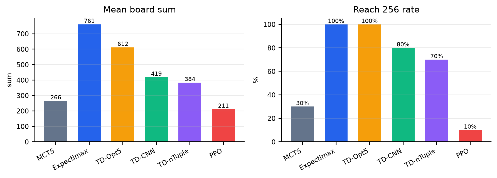
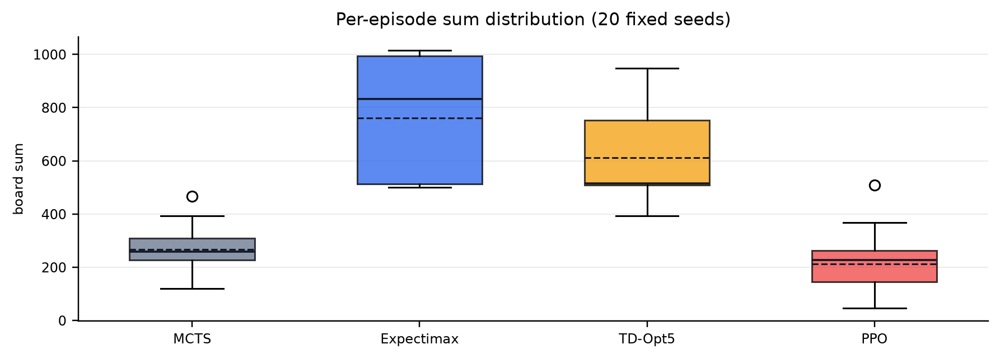

# 2048 游戏算法实验报告

**实验对象：** 3×3 版 2048，目标方块 256　　**小组成员：** 同学 A、同学 B、同学 C、同学 D

## 摘要

本实验在完全相同的 3×3 2048 环境中比较 MCTS、完整 Expectimax、三种 TD 检查点和 PPO。每个方法使用种子 10000–10019 的 20 局自然终局，统一统计终局棋盘和、达到 256 的局数和平均步数。完整 Expectimax 的平均 sum 最高（761.0），TD 乐观 5-tuple 次之（612.1）；MCTS 的搜索预算较小，PPO 检查点的训练量不足，二者分别为 266.0 和 211.4。报告重点放在方法的决策机制、计算代价和结果差异，而不是把某一种实现单独展开。

## 1. 实验设计与统一协议

每次移动后在空位随机生成 2（概率 0.9）或 4（概率 0.1），无合法动作时自然终局。所有方法使用相同种子集合，不设置步数上限，测试时不更新参数。终局和是棋盘九个方块之和；“通过”定义为最大方块不小于 256。训练阶段的局数或环境步数只用于说明检查点来源，不直接当作测试分数。

| 项目 | 统一设置 |
| --- | --- |
| 状态空间 | 3×3 棋盘，方块为 2 的幂次；目标方块 256 |
| 评测协议 | 每个方法 20 局，`seed=10000+i`，自然终局 |
| 指标 | 平均终局 sum、达到 256 的局数/比例、平均步数 |
| 实现 | 搜索方法在线决策；学习方法加载固定检查点并贪心执行 |

## 2. 算法原理与方法差异

下表按同一层次概括六个可比较对象。TD 的共同点是用下一 afterstate 的估计值更新当前价值；其中 5-tuple 只表示特征形状，乐观初始化是探索策略，不能与 CNN 或 n-tuple 的网络结构混为一谈。

| 方法 | 核心机制 | 状态表示 | 决策与代价 |
| --- | --- | --- | --- |
| MCTS | UCT 选择 + 随机出生块模拟 + 叶节点启发式 | 完整棋盘；树节点按局面缓存 | 每步重新搜索；效果随模拟次数增加，在线计算量高 |
| 完整 Expectimax | 玩家动作取最大，出生块取概率期望 | 完整棋盘 + 对称状态表 | 搜索到终局；结果稳定但建表和访问代价最高 |
| TD 乐观 5-tuple | TD(0) 更新局部特征查表值；初期高估未充分访问状态 | 3 张 `16^5` 表，24 个旋转/镜像特征 | 贪心查表；推理极快，依赖训练检查点质量 |
| TD-CNN | afterstate TD + Adam 梯度更新 | 11 个 one-hot 平面，79,874 参数 CNN | 一次批量前向；表达力强但需更多样本和训练稳定性 |
| TD-nTuple | TD(0) 更新行、列、2×2 方格特征表 | 离散 n-tuple 表，使用对称规范化 | 查表开销小；表示能力和收敛速度介于两类 TD 之间 |
| PPO | 剪切策略目标 + GAE + 熵正则 | 带动作掩码的卷积残差策略网络 | 训练成本高、测试前向快；对奖励尺度和样本量敏感 |

TD 是 Temporal-Difference learning：用下一状态的估计值构造当前更新目标。乐观 5-tuple 中，“5-tuple”表示每个特征模板读取 5 个格子；“乐观”表示训练初期对未充分访问的状态使用偏高先验以促进探索。它只是 TD 系列中的一种表示和初始化方案。

## 3. 训练、调参与工程优化

| 方法 | 训练/搜索预算 | 最终关键设置 |
| --- | --- | --- |
| MCTS | 无训练；每步 128 次模拟 | `depth=12`，`exploration=70`，`rollout_random=0.15` |
| Expectimax | 无训练；完整终局搜索 | `depth=null`，`empty_weight=18`，`order_weight=1`，`target_bonus=256` |
| TD 乐观 5-tuple | 300,000 局固定检查点 | `width=5`，`optimism=300`，`train_seed=42` |
| TD-CNN | 50,000 局；7,512,917 个位置 | Adam，`lr=3e-4`，`batch=1024`，epsilon `0.10→0.01` |
| TD-nTuple | 5,000 局 | `α=0.2`，epsilon `0.20→0.02`，`target_bonus=256` |
| PPO | 检查点 50,176 env steps | 64 filters，4 residual blocks，`γ=0.999`，`λ=0.95`，`clip=0.2` |

调参使用固定 20 局种子协议和单因素修改：MCTS/Expectimax 调搜索预算和启发式权重；TD 调学习率、探索率衰减、目标奖励和表/网络规模；PPO 调 γ、GAE、裁剪范围、熵系数和网络宽度。工程优化采用 D4 对称共享、afterstate 表示、批量前向、NumPy 推理、精确搜索缓存、梯度裁剪和独立 RNG。

## 4. 测试结果与统一比较

| 方法 | 平均 sum | 达到 256 | 平均步数 |
| --- | ---: | ---: | ---: |
| MCTS | 266.0 | 6/20（30%） | 119.45 |
| 完整 Expectimax | 761.0 | 20/20（100%） | 344.55 |
| TD 乐观 5-tuple | 612.1 | 20/20（100%） | 277.60 |
| TD-CNN | 418.8 | 16/20（80%） | 188.50 |
| TD-nTuple | 384.0 | 14/20（70%） | 172.15 |
| PPO | 211.4 | 2/20（10%） | 94.55 |





横向比较：Expectimax 在平均 sum 和通过率上第一，但它把大量计算放在运行前的状态表和每步机会树上；TD 乐观 5-tuple 的两项指标都达到 100%/20 局，在线只需有限次查表，适合资源受限的推理场景。TD-CNN 和 TD-nTuple 都明显超过 MCTS 基线，说明 afterstate 价值学习有效，但当前训练预算仍限制了收敛。MCTS 的优势是无需训练、可直接增加搜索预算；PPO 的策略执行很快，但当前检查点在样本量和奖励设计上还没有达到前三者的稳定性。

从“效果—在线成本—训练成本”三个维度看：Expectimax 是效果优先，乐观 5-tuple TD 是在线成本优先，CNN/n-tuple TD 是学习型折中，MCTS 是无需训练的搜索基线，PPO 是适合继续扩大训练规模的策略方法。由于预算不同，不能把表中排名解释为严格的等成本优越性。

## 5. 结论、局限、分工与复现

结论是：在当前 3×3 任务和固定检查点下，完整 Expectimax 得分最高；TD 乐观 5-tuple 以很低的在线计算量取得第二档效果；CNN/n-tuple TD 展示了进一步学习的空间；MCTS 和 PPO 分别受搜索预算、训练样本与奖励设置限制。下一步应使用多随机种子、统一 wall-clock/FLOPs 预算，并补充训练曲线，才能做更严格的成本公平比较。

局限：完整 Expectimax 的状态表缓存把一次性建表成本转移到离线阶段；乐观 5-tuple 检查点的原始训练入口目前不在 `train.py` 中；README 中的独立 500 局复测（平均 sum=639.408，463/500 达到 256）与本报告的 20 局固定协议用途不同。

| 成员 | 负责内容 |
| --- | --- |
| 同学 A | 环境适配、随机种子协议、基础规则和测试用例 |
| 同学 B | TD 系列、模型检查点和训练超参数 |
| 同学 C | MCTS、Expectimax、PPO 原理与搜索/策略配置 |
| 同学 D | 统一评测、图表、横向分析、报告撰写与 PDF 核验 |

复现实验：

```bash
uv run python -m unittest discover -s tests -v
uv run python -m game2048.wrappers.MCTS --episodes 20 --seed 10000 --output report/data/mcts.json
uv run python -m game2048.wrappers.Expectimax --episodes 20 --seed 10000 --output report/data/expectimax.json
uv run python -m game2048.wrappers.TD --episodes 20 --seed 10000 --output report/data/td.json
uv run python -m game2048.wrappers.ppo --episodes 20 --seed 10000 --output report/data/ppo.json
```

报告中的图表由 `report/generate_report.py` 根据固定评测 JSON 和仓库 README 的 TD-CNN、TD-nTuple 检查点摘要生成。
